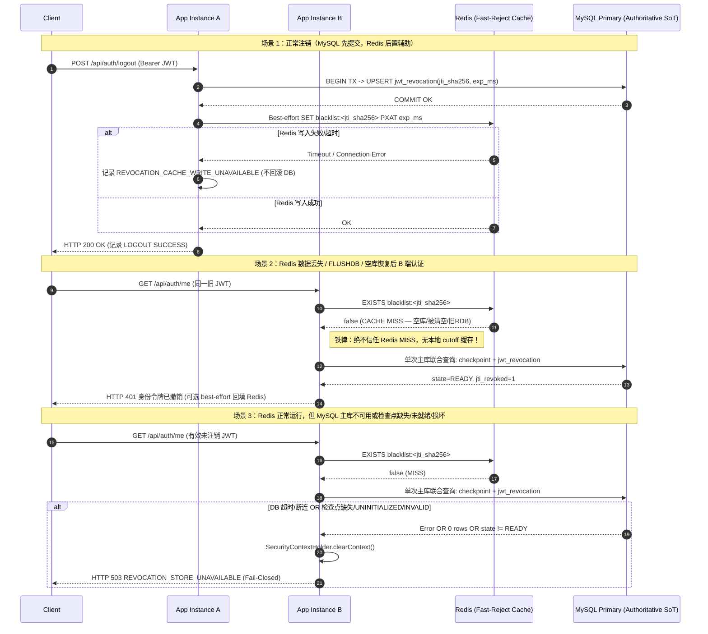

# #64 JWT 吊销状态持久化与 Redis 数据丢失安全恢复架构设计（ADR）

当前状态：`#64 OPEN / DESIGN_CANDIDATE / RED_VERIFIED / REVIEW_HARDENED`

> [!IMPORTANT]
> 本轮为基于独立设计审查反馈的**设计与测试门禁加固（DESIGN / TEST HARDENING ONLY）**，不修改 `src/main` 生产代码、不修改正式 MySQL Schema 或迁移脚本、不触碰生产 Redis/MySQL。文末 SQL DDL 仅为**非执行性设计草案**。在生产代码落地并完成真实 MySQL 8.4 + Redis 故障/数据丢失/检查点异常验收前，严禁将 `#64` 标记为 `FIXED`、`FIXED_VERIFIED` 或 `PRODUCTION_SAFE`。

---

## 1. 背景与精确源码依据

上一轮真实 Redis 双 JVM 验证（见 [issue29-64-real-validation-2026-11-12.md](issue29-64-real-validation-2026-11-12.md)）已证明：当 Redis 正常停机并由同目录恢复 RDB 时，已注销 JWT 在实例 A/B 上均保持 401；但当使用空 Redis 数据目录模拟持久化数据丢失后，尚未过期的已注销 JWT 在恢复后的 Redis 环境中重新获得 HTTP 200。

### 1.1 精确源码依据（基于基线 `c74867721adea57ad16012b4785b4f952b92fe86`）

| 模块 / 文件 | 关键符号与行号 | 当前实现行为与边界 |
|---|---|---|
| `TokenRevocationService.java` | `validateConfiguration()` (`L34-53`) | 强制非 `SINGLE_INSTANCE_LOCAL` 生产环境使用 `SHARED_REDIS_REQUIRED`（否则需显式审批例外）。 |
| `TokenRevocationService.java` | `revoke(String, Instant)` (`L55-74`) | `shared()` 模式下仅调用 `redis.strictPutMarker(key, expiresAt)` 写入 Redis，无任何数据库持久化写入。 |
| `TokenRevocationService.java` | `isRevoked(String)` (`L76-92`) | `shared()` 模式下仅调用 `redis.strictContains(key)`；若 Redis 返回 `false`（键不存在），直接判定未吊销。 |
| `TokenRevocationService.java` | `requireLoginStore()` (`L94-104`) | 登录前仅向 Redis 写读 5 秒 `login-probe` 键，不校验任何持久存储。 |
| `OptionalRedisService.java` | `strictContains()` (`L67-75`) | `redis.hasKey(key) == null` 时抛 `StrictRedisException("UNCONFIRMED")`，但 `false` 被注释为“confirmed absence”。 |
| `OptionalRedisService.java` | `strictPutMarker()` (`L78-90`) | 使用 `Expiration.unixTimestamp(expiresAt.toEpochMilli(), TimeUnit.MILLISECONDS)` + `SetOption.UPSERT` 写单键 `"1"`；Redis 单节点内存写入确认不等于磁盘/跨节点持久提交。 |
| `RevocationProperties.java` | `Mode` (`L12-18`) | 仅定义 `SINGLE_INSTANCE_LOCAL` 与 `SHARED_REDIS_REQUIRED`，尚无数据库权威持久化模式。 |
| `JwtAuthenticationFilter.java` | `doFilterInternal()` (`L37-71`) | 每次携带 Bearer Token 请求：`jwtService.parseClaims()` (`L46`) → `revocations.isRevoked(claims.getId())` (`L50`) → `authService.loadUser(claims.getSubject())` (`L56`)。注意 `loadUser` **本就每次请求查询 MySQL**。 |
| `JwtService.java` | `createToken()` (`L34-43`) / `parseClaims()` (`L49-51`) | 签发 `jti`（`UUID.randomUUID()`）、`sub`、`iat`、`exp`（默认 120 分钟），不含代际/版本号。 |
| `AuthService.java` | `login()` (`L31-55`) / `logout()` (`L82-92`) / `loadUser()` (`L58-65`) | `login` 先验证密码（401）、账号/角色启用（403），再调 `requireLoginStore()`；`logout` 调用 `revocations.revoke()` 后记 `LOGOUT SUCCESS`；`loadUser` 为 `@Transactional(readOnly = true)`。 |
| `HealthController.java` | `health()` (`L22-35`) | `/api/health` 为 `permitAll()`，探测 `SELECT 1` 与 `redis.ping()`，始终返回 HTTP 200 与状态字段。 |
| `SecurityResponseWriter.java` & `GlobalExceptionHandler.java` | `write()` (`L17-22`), `handleBusiness()` (`L36-39`) | 统一返回 `ApiResponse.fail(status, message)`，401/403/503 不回显底层异常、Redis 凭据或主机地址。 |
| `RevocationEvents.java` | `record()` (`L18-33`) | 结构化安全事件与 60s 限流告警，不记录 key/token/凭据。 |
| `doc/database/backend-v1-database-guide.md` & `pom.xml` | 迁移与持久化技术栈 | 项目使用 **MyBatis + JdbcTemplate**，**无 Flyway / Liquibase**；生产迁移通过 `doc/database/migrations/V4_001`..`V4_019` 顺序手工 SQL 执行，测试 H2 同步维护 `src/test/resources/schema.sql`。 |

### 1.2 漏洞根因本质

当前问题**不是**“Redis 连接失败未拦截”。连接失败、超时、ACL 写拒绝均已被 `StrictRedisException` + `RevocationStoreUnavailableException` 拦截为 HTTP 503。

真正的结构性漏洞在于：
1. **将易失性缓存当作唯一事实源（Source of Truth）**：Redis 被用作唯一持久化存储，而项目运维契约（[backend-v1-database-guide.md](../database/backend-v1-database-guide.md)、[backend-v1-operations.md](../deployment/backend-v1-operations.md)）明确规定“Redis 无需备份，因为它不保存业务事实”。
2. **负查询结果误判（False Negative on Empty Store）**：当 Redis 因空数据目录恢复、异常宕机丢失未刷盘写入、`FLUSHDB`、缓存淘汰（eviction）或主从异步切换丢数据时，恢复后的 Redis **能够正常响应 `EXISTS = false`**；应用把“键不存在”错误地解释为“令牌未被吊销”，从而让未过期但已确认注销的 JWT 复活（HTTP 200）。

---

## 2. 安全不变量定义（INV-01 ~ INV-07）

任何候选与最终方案必须同时满足以下可自动化验证的安全不变量：

| 编号 | 安全不变量 | 验证判定标准 |
|---|---|---|
| **INV-01** | **先持久提交后成功返回**：注销接口返回 HTTP 200 与记录 `LOGOUT SUCCESS` 前，撤销事实必须在权威持久存储中完成事务提交确认。 | 若权威存储写入/提交失败，`/api/auth/logout` 必须返回非 200（503），且不得记录 `LOGOUT SUCCESS`。 |
| **INV-02** | **全实例生命周期有效拒绝**：注销成功确认后至 JWT 自然过期（`exp`）前，该令牌在所有运行实例与新启动实例中均被拒绝。 | 多 JVM 跨实例查询同一旧 JWT 必须恒返回 HTTP 401（`身份令牌已撤销`或 `身份令牌已过期`）。 |
| **INV-03** | **Redis 任意状态丢失不复活旧令牌**：Redis 数据丢失、空目录启动、重启、`FLUSHDB`、回滚到旧 RDB 快照、缓存淘汰、异步主从切换均不得使旧 JWT 重新通过认证。 | 上述任一 Redis 异常恢复后，未过期已注销 JWT 不得获得 HTTP 200。 |
| **INV-04** | **不可靠状态必须 Fail-Closed**：当无法可靠判定令牌撤销状态（权威存储不可达、超时、事务失败、未确认提交，或全局检查点缺失/`UNINITIALIZED`/`INVALID`/字段异常）时，必须拒绝认证/注销/登录。 | 返回 HTTP 503 `REVOCATION_STORE_UNAVAILABLE`，并清除 `SecurityContextHolder`。 |
| **INV-05** | **跨实例线性可见性**：注销成功或检查点水位推进后，任何实例上的后续认证读不得因只读副本复制延迟、JVM 本地 TTL 缓存或未刷新快照而放行已失效令牌。 | 注销返回 200 或水位推进提交后，实例 B 立即认证必须 100% 拒绝；禁止在应用进程内缓存“未撤销”状态或本地缓存旧 `min_valid_iat_epoch_ms` 水位，禁止路由至延迟副本。 |
| **INV-06** | **既有兼容与语义不破坏**：不得破坏无 Token `/api/health`（Redis/存储故障时仍 200 报告状态）、登录错误优先级（密码错 401 / 停用 403 优先于存储预检 503）、RBAC/DataScope 校验及非生产 `SINGLE_INSTANCE_LOCAL` 本地开发模式。 | 回归测试覆盖所有上述既有语义保持不变。 |
| **INV-07** | **凭据与令牌零泄露**：日志、HTTP 异常响应、监控指标及持久表（除单向摘要外）不得记录完整 JWT、`JWT_SECRET`、Redis 密码、数据库连接串或内部主机地址。 | 日志与响应扫描无 `eyJ...`、`Bearer <token>`、明文密码及内网 Redis URI。 |

---

## 3. 架构方案对比评估

本节完整对比三个备选方案：
- **方案 A**：MySQL 持久化 revoked-JTI 表作为唯一权威事实源（Source of Truth），Redis 仅作可选辅助缓存（**推荐方案**）。
- **方案 B**：数据库用户/会话代际（细分 **B1 用户级 `token_version`** 与 **B2 会话表 `user_session`**）。
- **方案 C**：纯 Redis 持久化、主从复制、AOF/RDB、`WAIT`/`WAITAOF` 及备份恢复约束。

### 3.1 15 维全面评估矩阵

| 评估维度 | 方案 A：MySQL 权威 revoked-JTI + Redis 辅助（推荐） | 方案 B：数据库用户/会话代际（B1 / B2） | 方案 C：纯 Redis AOF/RDB + 复制 + WAIT/WAITAOF |
|---|---|---|---|
| **1. 安全不变量（INV-01~07）** | **全部满足**（前提：严禁将 Redis MISS 当作未吊销，MISS 必须回源 MySQL 主库）。 | B1 满足除“单设备独立注销”外的所有 INV；B2 全部满足。 | **无法严格保证 INV-01 / INV-03 / INV-05**（详见 3.2 节约束分析）。 |
| **2. 单令牌注销语义** | **精确支持**：按 `jti_sha256` 精确吊销当前令牌。 | B1 **不支持**（一次注销踢出同一用户全部设备）；B2 支持（按 `sid`）。 | 支持，但受限于 Redis 数据丢失窗口。 |
| **3. 多设备登录及单设备注销** | **原生支持**：同一用户多端登录产生不同 `jti`，单端注销不影响其他设备。 | B1 无法区分多设备；B2 支持但每次登录需创建会话行。 | 支持，但丢数据时全部设备旧令牌复活。 |
| **4. 注销与认证并发** | MySQL 主库 `COMMIT` 后返回 200；先于 `COMMIT` 的在途认证可能成功，**之后**所有认证因读主库最新提交均 401。 | 同左；B1/B2 对 `sys_user` 或 `user_session` 行读主库可见。 | 并发时若读写跨主从或宕机未刷盘，存在已返回 200 却未落盘窗口。 |
| **5. 数据丢失与错误恢复** | **抗 Redis 全丢**：Redis 空库、`FLUSHDB`、旧 RDB 恢复均只产生缓存 MISS，回源 MySQL 主库仍拒绝旧令牌。**注意**：普通 MySQL 备份恢复或时间点回滚（PITR）会使吊销记录与水位倒退，必须绑定第 5.5 节的强制轮换 `JWT_SECRET` + 推进水位 + 清空 Redis 安全恢复规程。 | 同左，依赖 MySQL 持久化；且同样受限于 MySQL 快照回滚时需轮换密钥的安全约束。 | **高危**：空目录启动、误删卷、旧 RDB 覆盖 AOF、内存淘汰均直接导致旧令牌复活（本轮 RED 已证）。 |
| **6. Redis 故障** | **安全降级可用**：Redis 宕机/超时时，认证与注销直连 MySQL 主库，仍满足 INV-01~05（可配置告警，不再整体 503）。 | 可完全不依赖 Redis；若用 Redis 缓存代际仍需应对旧快照。 | **全面不可用或安全失效**：严格模式全站 503；若降级放行则彻底失去撤销保护。 |
| **7. MySQL 故障** | **Fail-Closed 503**：注销、登录预检、检查点校验异常及 Redis MISS 认证均返回 503；`/api/health` 保持 200 并报告 `database=DOWN`。 | 全链路认证/登录/注销 fail-closed 503（注：`loadUser` 本就依赖 MySQL）。 | 若仅依赖 Redis，MySQL 宕机时 `loadUser` 仍会失败；且无法用 MySQL 兜底 Redis 丢数据。 |
| **8. 多 JVM / 多节点** | 所有实例共享同一 MySQL 主库事实源，跨节点零本地状态依赖（严禁 JVM 本地缓存检查点水位）。 | 同左。 | 需所有 JVM 严格连接同一主节点且无连接池指向滞后副本。 |
| **9. 主从复制与读写延迟** | 规定吊销读写与检查点读取**强制绑定 MySQL 主库**（Primary RW），禁止路由至只读副本，消除复制延迟。 | 同左，需强制读主库。 | Redis 主从为**异步复制**，Sentinel/Cluster 故障切换可能提升滞后从库，直接丢失已 ACK 的撤销写入。 |
| **10. 令牌有效期与时钟偏差** | 以 `expires_at_epoch_ms`（UTC 毫秒）比对；定期清理保留 5 分钟时钟偏差宽限期（grace skew）；`min_valid_iat_epoch_ms` 强制向上整秒对齐以匹配 JWT 秒级 `iat`。 | B2 会话过期同左；B1 用户版本号无 TTL 清理需求，但需防整数溢出（BIGINT 足够）。 | 依赖 Redis 服务端 `PEXPIRETIME` 与应用主机时钟一致性，跨节点 NTP 漂移可能提前过期。 |
| **11. 延迟与吞吐成本** | **可接受**：`JwtAuthenticationFilter` 每次请求**本就执行 `authService.loadUser()` 访问 MySQL 2~4 次**；将检查点读取与 `jwt_revocation` 点查合并为**单次 MySQL 主库联合查询**（约 0.2~0.5ms），零额外往返；Redis 仅命中黑名单时省去 DB 查询（防失效令牌重放风暴）。 | B1 可直接合并进 `authMapper.selectByUsername()`（0 额外 SQL），代价是丧失单设备注销；B2 每登录多 1 次 INSERT、每请求多 1 次 `sid` 校验。 | 网络 RTT 最低，但开启 `appendfsync always` + `WAIT`/`WAITAOF` 后写入尾延迟剧增且受网络抖动阻塞。 |
| **12. 存储规模与清理成本** | 仅存“有效期内提前注销”的令牌，默认有效期 120 分钟；按峰值每小时数千次注销计，表规模常驻仅数百~数万行，有界批量清理极快。 | B1 零额外表增长；B2 需为**每次登录**建行（比仅存注销行大 1~2 个数量级）。 | 内存存储，受 `maxmemory` 限制；一旦触发淘汰策略即丢失黑名单。 |
| **13. 生产部署复杂度** | **低**：复用现有 MySQL 8 唯一事实源；Redis 保持可选加速角色，完全契合仓库运维指南。 | **低~中**：同样复用现有 MySQL 8，无需新增运维组件。 | **极高**：需部署 Redis Sentinel/Cluster、AOF `always`、RDB/AOF 异地备份、禁止空目录启动护栏、`min-replicas-to-write`、禁用 `FLUSHDB`/淘汰等，且 Windows 环境无官方企业级支持。 |
| **14. 数据迁移及回滚风险** | 新增独立表 + 显式三态检查点表（`UNINITIALIZED`/`READY`/`INVALID`），**不改业务表结构**；切换与回滚必须遵守第 5 节水位激活与密钥轮换约束。 | 需修改 `sys_user` 表或新增会话表，且必须改造 `JwtService` Payload 契约与现有测试。 | 无法通过 SQL 脚本保证，高度依赖外部基础设施人工配置审计。 |
| **15. 对现有代码的侵入程度** | **低~中**：无需改动 JWT 载荷格式、`LoginVO`、业务 Controller 或前端；仅扩展 `TokenRevocationService`、`RevocationProperties` 及新增 MyBatis/JDBC 持久化与切面。 | B1 改 `JwtService` + `AuthMapper` + `sys_user`；B2 需大改登录/会话生命周期与大量既有测试断言。 | 仍需改造应用支持 `WAIT`/`WAITAOF`/epoch 护栏，且无法消除空库恢复后的结构性盲区。 |

### 3.2 为何不能仅靠方案 C（即使启用 AOF/RDB 与 WAIT/WAITAOF）

设计评审中常见误区是认为“只要给 Redis 配上 `appendonly yes` + `appendfsync always` + `WAIT`，就可以保证所有已确认撤销不丢失”。本项目明确否决该假设，原因如下：
1. **`appendfsync everysec` 存在 1~2 秒丢失窗口**；即使设为 `always`，仍无法防御宿主磁盘损坏、容器/脚本以空目录挂载重启、人工误操作或 `FLUSHDB`。
2. **`WAIT` / `WAITAOF` 无法提供分布式强一致线性提交**：Redis 复制为异步流；当主节点写入本地内存后若 `WAIT` 超时，撤销标记其实已留存在原主节点但客户端收到失败，或主节点在复制到多数派前宕机、Sentinel 仍可能触发人工/自动故障切换提升滞后从库；`WAITAOF` 在单机双盘或主从切换时同样受限于 Redis 的非 Raft 共识模型。
3. **空目录恢复误判不可消除**：一旦发生任何基础设施失误导致 Redis 以空库启动，应用层无法从 `EXISTS = false` 区分“从未吊销”与“Redis 刚丢了数据”。
4. **违背项目既有运维契约**：[backend-v1-database-guide.md](../database/backend-v1-database-guide.md) 与 [backend-v1-operations.md](../deployment/backend-v1-operations.md) 明确规定 Redis 仅为可选缓存且无需备份。

### 3.3 推荐方案结论

**推荐采用方案 A（MySQL 持久化 `jwt_revocation` + `jwt_revocation_checkpoint` 为权威事实源，Redis 仅作可选“已吊销快速拒绝缓存”），并吸收方案 B1 的轻量全局/用户级时间水位线思想用于上线安全切换与应急失效。**

核心理由：
- 彻底消除 Redis 数据丢失/空库恢复/旧 RDB 导致的旧令牌复活（满足 INV-01~05）。
- 精确保留单设备/单令牌注销语义，不改变 JWT Payload 或前端登录/注销协议（满足 INV-06）。
- `JwtAuthenticationFilter` 本就每请求访问 MySQL `loadUser`，增加 1 次定长 `CHAR(64)` 主键/唯一索引点查在性能上完全可控，且 Redis 仍可拦截高频已吊销重放请求。

---

## 4. 方案 A 详细设计（面向下一轮开发）

### 4.1 持久化记录的数据字段与摘要脱敏规则

1. **禁止存储原始 JWT**：遵循 INV-07 与 [backend-sensitive-data-audit.md](../security/backend-sensitive-data-audit.md)，数据库与 Redis 中绝不保存完整 JWT 字符串。
2. **存储 `jti_sha256`（`CHAR(64)`）**：对 JWT 的 `jti`（UUID 字符串）做小写 64 位十六进制 SHA-256 摘要（与仓库 `V4_016_s4a_entity_resolution.sql` 中的 `resolution_token_sha256 CHAR(64)` 规范一致），作为定长业务主键/唯一键，避免超长或异常 `jti` 导致的索引截断与日志泄露风险。
3. **核心表结构语义**：
   - **`jwt_revocation`**（已撤销令牌表）：
     - `revocation_id` (`BIGINT AUTO_INCREMENT PK`)
     - `jti_sha256` (`CHAR(64) NOT NULL`) — 唯一键 `uk_jwt_revocation_jti_sha256`
     - `user_id` (`BIGINT NULL`) — 关联 `sys_user.user_id`（仅作审计溯源，认证主查询不依赖它）
     - `expires_at_epoch_ms` (`BIGINT NOT NULL`) — JWT `exp` 的 UTC 毫秒时间戳（**所有过期判定与清理比较均以此整型列为准，彻底规避 MySQL `serverTimezone`、夏令时与多 JVM 本地时区差异**）
     - `token_expires_at` (`DATETIME(3)` / H2 `TIMESTAMP` `NOT NULL`) — 人类可读过期时间（UTC 或与连接时区一致，仅供 DBA 巡检）
     - `revoked_at` (`DATETIME(3)` / H2 `TIMESTAMP` `NOT NULL`) — 注销提交时间
     - `revocation_reason` (`VARCHAR(32) NOT NULL DEFAULT 'LOGOUT'`) — 预留 `LOGOUT` / `ADMIN_REVOKE`
     - `instance_id` (`VARCHAR(64) NULL`) / `trace_id` (`VARCHAR(64) NULL`) — 来自 `S2TraceContext`
     - `created_at` (`DATETIME(3)` / H2 `TIMESTAMP` `NOT NULL DEFAULT CURRENT_TIMESTAMP`)
   - **`jwt_revocation_checkpoint`**（全局/切换安全水位表，显式三态管理）：
     - `checkpoint_key` (`VARCHAR(64) PK`) — 固定 `'GLOBAL_JWT_CUTOFF'`
     - `checkpoint_state` (`VARCHAR(32) NOT NULL DEFAULT 'UNINITIALIZED'`) — 显式三态枚举：`UNINITIALIZED` / `READY` / `INVALID`
     - `min_valid_iat_epoch_ms` (`BIGINT NOT NULL DEFAULT 0`) — 凡 `iat < min_valid_iat_epoch_ms`（或缺失 `iat`）的 JWT 一律视为已失效（401）；`READY` 态下必须严格为 `> 0` 且为 `1000` 的正整数倍（整秒毫秒对齐）
     - `activation_mode` (`VARCHAR(32) NULL`) — 仅 `READY` 态非空，限定为 `'CUTOVER'`（旧系统升级切换）、`'INITIAL_EMPTY_CLUSTER'`（全新无存量集群首次激活）、`'EMERGENCY_ROTATION'`（紧急全量失效/备份恢复重置）
     - `checkpoint_version` (`BIGINT NOT NULL DEFAULT 0`) — 单调递增版本号（`UNINITIALIZED` 为 `0`，首次激活为 `1`，每次合法推进 `+1`）
     - `updated_by` (`VARCHAR(64) NULL`) / `updated_at` (`DATETIME(3)` / H2 `TIMESTAMP` `NOT NULL DEFAULT CURRENT_TIMESTAMP`)

### 4.1.1 检查点三态语义与 Fail-Closed 契约（禁止 Fail-Open）

> [!CAUTION]
> **安全铁律（阻断项 A）**：绝不允许通过 `COALESCE(..., 0)` 把缺失行转换为 `0`，也绝不允许将 `UNINITIALIZED` 态的默认水位 `0` 自动当作已完成生产安全切换而放行任何存量 JWT。

1. **三态显式定义与合法充要条件**：

| 状态 | 字段约束 | 运行期 `DURABLE_DB_REQUIRED` 行为 | 启动期 `validateConfiguration()` 行为 |
|---|---|---|---|
| **`UNINITIALIZED`** | 初始 DDL 创建或尚未执行上线激活：`checkpoint_state = 'UNINITIALIZED'`、`min_valid_iat_epoch_ms = 0`、`activation_mode IS NULL`、`checkpoint_version = 0`。 | **Fail-Closed HTTP 503**（`REVOCATION_STORE_UNAVAILABLE`），记 `REVOCATION_CHECKPOINT_INVALID` 告警；**严禁以 `0` 水位放行请求**。 | **拒绝启动（Fail-Fast）**，提示未完成 `GLOBAL_JWT_CUTOFF` 首次激活或升级切换。 |
| **`READY`** | 必须同时满足全部 5 项不变量：<br>① `checkpoint_state = 'READY'`<br>② `min_valid_iat_epoch_ms > 0`<br>③ `min_valid_iat_epoch_ms % 1000 == 0`（整秒对齐）<br>④ `activation_mode IN ('CUTOVER', 'INITIAL_EMPTY_CLUSTER', 'EMERGENCY_ROTATION')`<br>⑤ `checkpoint_version >= 1` | 正常依据 `min_valid_iat_epoch_ms` 与 `jwt_revocation` 判定 200 / 401。 | 允许启动，并在启动日志记录当前 `checkpoint_version`（不输出敏感信息）。 |
| **`INVALID`** | 显式写入 `checkpoint_state = 'INVALID'`，或任一字段违反上述 `UNINITIALIZED`/`READY` 不变量（例如 `READY` 但 `min_valid_iat_epoch_ms <= 0`、非 `1000` 整数倍、`activation_mode` 未知/为空、`checkpoint_version < 1`），或查询返回 0 行（缺失行）。 | **Fail-Closed HTTP 503**（`REVOCATION_STORE_UNAVAILABLE`），记 `REVOCATION_CHECKPOINT_MISSING` 或 `REVOCATION_CHECKPOINT_INVALID`。 | **拒绝启动（Fail-Fast）**，需 DBA 核查并按安全操作规程推进检查点或轮换密钥。 |

2. **检查点 10 项强制安全契约**：
   1. **缺失检查点行 → Fail-Closed 503**：查询 `WHERE checkpoint_key = 'GLOBAL_JWT_CUTOFF'` 返回 0 行时，直接抛 `RevocationStoreUnavailableException`（HTTP 503），禁止 `COALESCE(..., 0)` 降级放行。
   2. **检查点字段无效 → Fail-Closed 503**：`checkpoint_state != 'READY'`（含 `UNINITIALIZED`、`INVALID`、未知枚举）或 `READY` 任一字段不满足合法约束时，一律抛 `RevocationStoreUnavailableException`（HTTP 503）。
   3. **数据库查询失败 → Fail-Closed 503**：数据库连接失败、超时、表缺失或 SQL 异常一律抛 `RevocationStoreUnavailableException`（HTTP 503）。
   4. **生产新模式启动前强制校验**：`TokenRevocationService.validateConfiguration()` 在 `DURABLE_DB_REQUIRED` 启动阶段必须执行主库只读校验，确认 `GLOBAL_JWT_CUTOFF` 行存在且满足全部 `READY` 不变量，否则拒绝启动。
   5. **从旧系统升级时校验切换水位**：必须先停止全部 `v_old` 实例并记录停机完成时刻 `T_stop_all_old_ms`，随后执行 `CUTOVER` 激活 SQL 将水位推进至向上取整的下一整秒 `cutoff_ms = (floor(T_stop_all_old_ms / 1000) + 1) * 1000`，等待时钟越过 `cutoff_ms`（至多 1 秒）且验证 `checkpoint_state = 'READY'` 与 `min_valid_iat_epoch_ms >= cutoff_ms` 后，才允许启动 `v_new`。
   6. **禁止空表 + 0 水位放行存量 JWT**：`min_valid_iat_epoch_ms = 0` 仅存在于 `UNINITIALIZED` 未激活占位态；任何线上认证路径均不得接受 `min_valid_iat_epoch_ms <= 0` 作为有效放行边界。
   7. **全新部署且无存量 JWT 的可验证首次激活条件（`INITIAL_EMPTY_CLUSTER`）**：即使是首次全新部署，也**不自动使用 `0` 水位放行**；运维或部署流程必须在满足以下三项可验证前置条件后显式执行首次激活 SQL，使检查点从 `UNINITIALIZED` 跃迁为 `READY`：
      - 前置条件 ①：确认不存在任何正在运行或曾签发过令牌的 `v_old` 实例，且当前 `jwt_revocation` 表记录数为 `0`；
      - 前置条件 ②：本次部署已配置新签发密钥 `JWT_SECRET`（确保历史上不可能存在以同密钥签发的未受控 JWT）；
      - 前置条件 ③：激活语句显式写入 `checkpoint_state = 'READY'`、`activation_mode = 'INITIAL_EMPTY_CLUSTER'`、`min_valid_iat_epoch_ms = (FLOOR(UNIX_TIMESTAMP(CURRENT_TIMESTAMP(3))) + 1) * 1000`（正整秒毫秒值）、`checkpoint_version = 1`，随后等待至 `clock.millis() >= min_valid_iat_epoch_ms` 再开放对外流量。
   8. **检查点更新必须单调不减**：所有应用或运维 SQL 更新必须带单调谓词 `WHERE checkpoint_key = 'GLOBAL_JWT_CUTOFF' AND #{newCutoffMs} > 0 AND (#{newCutoffMs} % 1000) = 0 AND #{newCutoffMs} >= min_valid_iat_epoch_ms` 并自增 `checkpoint_version = checkpoint_version + 1`；并在 MySQL 8.4 DDL 中配备 `CHECK` 约束与 `BEFORE UPDATE` 触发器，从数据库引擎层禁止水位倒退、版本号倒退或从 `READY` 退回 `UNINITIALIZED`。
   9. **禁止普通启动脚本重置水位为 0**：DDL 迁移脚本仅可使用 `INSERT IGNORE`（MySQL）或“仅当主键不存在时插入”（H2）来写入初始 `UNINITIALIZED` 占位行；禁止使用 `REPLACE INTO`、`ON DUPLICATE KEY UPDATE min_valid_iat_epoch_ms = 0` 或应用启动脚本无条件覆盖检查点行。
   10. **备份/快照回滚安全约束**：从旧 MySQL 备份恢复、PITR 时间点回滚或提升滞后从库时，严禁直接复用回滚后的旧检查点与旧吊销表接管流量；必须先执行第 5.5 节安全恢复操作规程（强制轮换 `JWT_SECRET` 并推进水位为 `EMERGENCY_ROTATION`）。

### 4.1.2 JWT `iat` 秒级精度与 `cutoff` 毫秒精度关系（精确源码对照）

- **源码事实**：`JwtService.createToken()` (`L37-42`) 调用 `Jwts.builder().issuedAt(Date.from(now))...compact()`。按 RFC 7519 第 2 节 `NumericDate` 规范及 JJWT 默认序列化行为，`iat` 与 `exp` 声明在 JWT JSON Payload 中以**秒级整数时间戳**存储（即毫秒部分被截断：假设签发瞬时为 `1763000000850 ms`，JWT 解析回来的 `claims.getIssuedAt().toInstant().toEpochMilli()` 为 `1763000000000 ms`，丢失了 `850 ms` 尾数）。
- **毫秒级 cutoff 截断漏洞分析**：
  - 若旧令牌 `T_legacy` 于 `1763000000150 ms` 签发，其声明 `iat_ms = 1763000000000 ms`；
  - 若在 `1763000000600 ms` 停旧并直接将 `min_valid_iat_epoch_ms` 设为 `1763000000600 ms`（带非零毫秒），虽然 `T_legacy`（`1763000000000 < 1763000000600`）会被拒绝，但紧接着在 `1763000000750 ms` 合法签发的新令牌 `T_fresh` 序列化后同样只保留整秒 `iat_ms = 1763000000000 ms`，导致刚登录的 `T_fresh` **也被误杀为 401**；反之，若有人为避免误杀而向下取整到 `1763000000000 ms`，则同一秒前半段 `000~599 ms` 签发的 `T_legacy` 又会被**错误放行**！
- **确定性对齐规则（无盲区、无误杀）**：
  1. **整秒毫秒强制约束**：`min_valid_iat_epoch_ms` 在 `READY` 状态下**必须始终是 `1000` 的正整数倍**（即 `min_valid_iat_epoch_ms % 1000 == 0`），数据库 `CHECK` 约束与 Java 解析校验同时强校验此不变量。
  2. **向上取整下一整秒**：无论是 `CUTOVER`、`INITIAL_EMPTY_CLUSTER` 还是 `EMERGENCY_ROTATION` 推进水位，针对事件完成时刻 `T_event_ms`，统一计算：
     $$\text{cutoff\_ms} = \left(\left\lfloor \frac{T_{\text{event\_ms}}}{1000} \right\rfloor + 1\right) \times 1000$$
  3. **至多 1 秒屏障等待**：设置完成后，激活流程（维护窗口启新前 / 紧急失效完成确认前 / 新集群开放登录前）必须等待当前系统时钟进入 `clock.millis() >= cutoff_ms`（最多耗时 1000ms），才允许签发新 JWT 或返回推进完成成功响应。由此保证：
     - **安全性**：在 `T_event_ms` 及之前签发的一切旧令牌，其整秒 `iat_ms <= floor(T_event_ms / 1000) * 1000 < cutoff_ms`，**100% 被 `< cutoff_ms` 拒绝（零漏放）**；
     - **可用性**：在屏障等待后签发的一切新令牌，其整秒 `iat_ms >= cutoff_ms`，**100% 满足 `iat_ms >= min_valid_iat_epoch_ms`（零误杀）**。
  4. **认证比对公式**：解析 JWT 后若 `claims.getIssuedAt() == null` 或 `claims.getIssuedAt().toInstant().toEpochMilli() < min_valid_iat_epoch_ms`，一律判定失效并返回 HTTP 401 `身份令牌已撤销`。

### 4.2 唯一键、索引、过期时间与有界清理规则

- **唯一键**：`UNIQUE KEY uk_jwt_revocation_jti_sha256 (jti_sha256)` — 保证幂等写入与 O(log N) 点查。
- **清理索引**：`KEY idx_jwt_revocation_expires_ms (expires_at_epoch_ms)` — 支持按时间窗口低锁范围扫描删除。
- **审计索引**：`KEY idx_jwt_revocation_user_id (user_id)` — 便于安全排查某用户的近期注销记录。
- **清理规则与时钟偏差边界**：
  - `@Scheduled(fixedDelayString = "${security.jwt.revocation.cleanup-interval:PT30S}")` 定期执行有界批量清理。
  - 清理截止水位：`cleanupCutoffMs = clock.millis() - cleanupGraceSkewMs`（默认宽限 `cleanupGraceSkewMs = 300_000L`，即 5 分钟），绝不删除仍在任何节点时钟偏差容忍期内的记录。
  - 批量删除语句：`DELETE FROM jwt_revocation WHERE expires_at_epoch_ms <= #{cutoffMs} ORDER BY expires_at_epoch_ms ASC LIMIT #{batchSize}`（H2 兼容写法可先查出 `LIMIT #{batchSize}` 的 `revocation_id` 集合再按主键 `IN (...)` 删除，既避免全表锁又兼顾 MySQL 8.4 与 H2 语法统一）。
  - **清理与认证边界并发**：因清理保留 5 分钟宽限期，而 `JwtService.parseClaims()` 默认容忍偏差为 0s，故任何在宽限期内被删除的记录其 JWT 早已被 `ExpiredJwtException` 拦截为 401 `身份令牌已过期`，不存在“刚删行但令牌未过期”的竞态窗口。

### 4.3 注销写入事务、幂等性与提交确认

1. **输入校验与过期语义**：延续 `TokenRevocationService.revoke` 现有校验，`jti` 为空或 `expiresAt` 已过期在严格/持久模式下均抛 401 `BusinessException`。
2. **MySQL 先提交事务（Transaction First）**：
   - 在独立持久化 Service（如 `JdbcTokenRevocationStore` 或 `JwtRevocationMapper`）中使用 `@Transactional(propagation = Propagation.REQUIRES_NEW, rollbackFor = Exception.class)` 执行幂等 upsert：
     - MySQL：
       ```sql
       INSERT INTO jwt_revocation (
           jti_sha256, user_id, expires_at_epoch_ms, token_expires_at,
           revoked_at, revocation_reason, instance_id, trace_id
       ) VALUES (
           #{jtiSha256}, #{userId}, #{expiresAtEpochMs}, #{tokenExpiresAt},
           #{revokedAt}, #{reason}, #{instanceId}, #{traceId}
       )
       ON DUPLICATE KEY UPDATE
           expires_at_epoch_ms = GREATEST(expires_at_epoch_ms, VALUES(expires_at_epoch_ms))
       ```
     - H2 `MODE=MySQL`：可使用 `MERGE INTO jwt_revocation (jti_sha256, ...) KEY (jti_sha256) VALUES (...)` 或捕获 `DuplicateKeyException` 后执行单条 `UPDATE ... WHERE jti_sha256 = ? AND expires_at_epoch_ms < ?`（跨数据库零方言差异的最佳实现为：`INSERT` → 若报 `DuplicateKeyException` 则确认存在且必要时延长 `expires_at_epoch_ms`，确保幂等重复注销均成功返回）。
   - **禁止先写 Redis 再提交 MySQL**：绝不允许出现在 MySQL 事务回滚时 Redis 已写入脏黑名单的情况。
3. **Post-Commit 写 Redis 辅助缓存**：
   - 仅当 MySQL 事务**已确认提交成功**后，再执行 best-effort `redis.strictPutMarker(redis.key("security:jwt:blacklist:" + jtiSha256), expiresAt)`（或沿用 `jti` 派生键，建议统一为 `jtiSha256` 以防键名携带原始结构）。
   - 若此时 Redis 写入失败（连接断开、ACL 拒绝、超时）：记录 `REVOCATION_CACHE_WRITE_UNAVAILABLE` 告警并计数，**但注销接口仍返回 HTTP 200 且记录 `LOGOUT SUCCESS`**，因为 MySQL 权威状态已提交，后续所有实例在 Redis MISS 时会直接从 MySQL 主库读取到该吊销记录。
   - 若 MySQL 写入或事务提交失败：立即抛出 `RevocationStoreUnavailableException`（HTTP 503），**不写 Redis、不写 `LOGOUT SUCCESS` 审计、不放行返回 200**。

### 4.4 认证读取顺序、检查点即时一致性与 Redis 信任边界

> [!CAUTION]
> **核心铁律**：
> 1. 绝对禁止在任何生产/多实例模式中将 Redis 的“键不存在（MISS）”直接认定为“令牌未撤销”。
> 2. **严禁对全局检查点 `min_valid_iat_epoch_ms` 使用进程内 TTL 本地缓存（如原草案的 5 秒缓存）**：在未证明跨实例同步屏障绝对实时且不会放行已失效令牌前，**禁止任何本地 JVM cutoff 缓存优化**。
> 3. **检查点缺失或异常必须 Fail-Closed**：禁止在 SQL 中使用 `COALESCE(..., 0)` 掩盖缺失行。

严格认证读取顺序（`JwtAuthenticationFilter` → `TokenRevocationService.isRevoked`）：
1. **JWT 验签与基础声明校验**（`JwtService.parseClaims`）：验证 HMAC 签名、`exp > now`、`jti` 非空、`iat != null`。过期返回 401 `身份令牌已过期`；签名/格式错或缺少 `jti`/`iat` 返回 401 `身份令牌无效`。
2. **Redis 辅助快速拒绝检查（仅允许正向命中拒绝，不允许 MISS 放行）**：
   - 若 Redis 已启用且可用，尝试查询 `blacklist:<jti_sha256>`：
     - **Redis 快速拒绝命中允许直接返回 401**：若返回 `true`（命中），**立即拒绝**，返回 401 `身份令牌已撤销`，记录 `REVOCATION_REJECTED_CACHE`（无需再查询 MySQL；因为任何后续 `cutoff` 推进只会单调扩大拒绝集合，命中单令牌黑名单后的直接拒绝绝不会导致越权放行）。
     - **Redis MISS 或异常不得放行**：若返回 `false`（MISS）或 Redis 抛出超时/连接/认证异常：记录缓存异常统计（若异常），**不得放行，必须进入步骤 3**。
3. **权威 MySQL 主库单次合并点查（检查点即时一致性 + revoked-JTI）**：
   - 每次经步骤 2 未被拒绝的请求，使用独立短读（`READ COMMITTED` / autocommit，绝不复用外层长事务旧快照）强制路由至 **MySQL Primary (RW)**，在**单次 SQL 查询**中同时读取权威检查点状态与 `jwt_revocation` 命中结果（零额外网络往返，消除进程内 5 秒缓存导致的跨实例水位生效延迟窗口）：
     ```sql
     SELECT
       c.checkpoint_key,
       c.checkpoint_state,
       c.min_valid_iat_epoch_ms,
       c.activation_mode,
       c.checkpoint_version,
       EXISTS(
         SELECT 1 FROM jwt_revocation r
         WHERE r.jti_sha256 = #{jtiSha256}
           AND r.expires_at_epoch_ms > #{nowEpochMs}
       ) AS jti_revoked
     FROM jwt_revocation_checkpoint c
     WHERE c.checkpoint_key = 'GLOBAL_JWT_CUTOFF'
     ```
   - **严格判定规则（Fail-Closed 优先于一切放行）**：
     - **情况 1（检查点缺失 / 未激活 / 无效 / DB 异常）**：若查询返回 **0 行**、或抛出任何连接/超时/SQL 异常、或 `checkpoint_state != 'READY'`（含 `UNINITIALIZED`、`INVALID`、未知枚举）、或 `min_valid_iat_epoch_ms <= 0`、或 `min_valid_iat_epoch_ms % 1000 != 0`、或 `activation_mode NOT IN ('CUTOVER', 'INITIAL_EMPTY_CLUSTER', 'EMERGENCY_ROTATION')`、或 `checkpoint_version < 1`：
       → **立即 Fail-Closed**，抛出 `RevocationStoreUnavailableException`，清除 `SecurityContextHolder`，返回 **HTTP 503 `REVOCATION_STORE_UNAVAILABLE`**，并记录 `REVOCATION_CHECKPOINT_MISSING` / `REVOCATION_CHECKPOINT_INVALID` / `REVOCATION_DB_UNAVAILABLE`。
     - **情况 2（命中水位截断或单令牌吊销）**：在满足合法 `READY` 校验的前提下，若 `jti_revoked == 1` 或 `iat.toEpochMilli() < min_valid_iat_epoch_ms`：
       → 返回 `revoked = true`，响应 **HTTP 401 `身份令牌已撤销`**。（若 `jti_revoked == 1` 且此前 Redis 为 MISS，可异步或顺带 best-effort 回填 Redis `PXAT` 缓存，防无效令牌重放风暴；若仅命中全局 `cutoff` 则直接 401。）
     - **情况 3（权威确认放行）**：仅当 `checkpoint_state == 'READY'` 且满足全部字段约束、`iat.toEpochMilli() >= min_valid_iat_epoch_ms` 且 `jti_revoked == 0` 时，才确认未撤销并放行至 `authService.loadUser(username)`。
   - **为什么不采用“JVM 本地缓存 + 通知优化”**：即使增加本地单调缓存或 Redis Pub/Sub 失效通知，在网络分区、Pub/Sub 断线重连或定时刷新间隔内，仍可能出现“实例 A 已推进 `min_valid_iat_epoch_ms` 强制失效某批令牌，而实例 B 因持有旧的缓存 `cutoff` 而在窗口内继续放行”的反例。由于 `JwtAuthenticationFilter` 本就每请求通过 `authService.loadUser()` 访问 MySQL 主库多次，直接将检查点读取合并进单次主库点查（同库 1 次往返）即可 **100% 证明零缓存延迟窗口**，无需且禁止引入不可证明零窗口的本地缓存优化。

### 4.5 关键事务与故障时序图



### 4.6 10 大关键故障、检查点与并发边界处理清单

| 边界场景 | 行为与机制保证 | 结果 |
|---|---|---|
| **1. MySQL 提交成功，Redis 辅助写入失败** | DB 事务先提交后才写 Redis；Redis 异常仅记限流日志与计数。 | 注销返回 200；B 端在 Redis MISS 后查 MySQL 主库仍拒绝旧 JWT（401）。 |
| **2. Redis 写入成功但 MySQL 事务回滚** | 禁止在 DB `COMMIT` 前写入 Redis；彻底根除“先写缓存后写库”导致的状态分裂。 | 不会发生脏黑名单残留；DB 回滚直接映射为 503，不记 `LOGOUT SUCCESS`。 |
| **3. DB 已提交瞬间，实例 B 同时认证** | `JwtAuthenticationFilter` 使用主库独立短读（`READ COMMITTED` / autocommit），在注销返回 200 后发起的任何请求均处于 MySQL 事务提交之后。 | B 端立即可见，返回 401（满足 INV-05）。 |
| **4. 主库提交成功，只读副本尚未同步** | 本模块显式禁止数据源读写分离到只读副本；吊销写入与联合点查均强制走 Primary RW DataSource。 | 零副本延迟复活窗口（满足 INV-05）。 |
| **5. Redis 正常但发生 `FLUSHDB`** | `FLUSHDB` 后 Redis 对所有键返回 `EXISTS = false`（MISS）；因 MISS 强制回源 MySQL 主库，仍命中 `jwt_revocation`。 | 旧 JWT 仍返回 401（满足 INV-03）。 |
| **6. Redis RDB 恢复到旧时间点快照** | 旧 RDB 缺少快照时间点之后的新注销键 → 返回 MISS → 强制查 MySQL 主库；同时因**不缓存“未撤销”正向结果**，旧 RDB 绝不会给出错误放行信号。 | 旧 JWT 仍返回 401（满足 INV-03）。 |
| **7. 定期清理与过期边界并发** | 清理任务仅删除 `expires_at_epoch_ms <= now - 300_000`（5 分钟宽限期）；此时所有满足删除条件的 JWT 均已超过 `exp` 5 分钟，必被 `JwtService.parseClaims` 拒绝为 `ExpiredJwtException` (401)。 | 清理与认证之间无竞态漏洞。 |
| **8. 检查点行缺失 / `UNINITIALIZED` / `INVALID`** | 移除 `COALESCE(..., 0)`；每次联合查询直接校验 `checkpoint_state='READY'` 且所有字段合规；启动期 `validateConfiguration()` 同样强制预检。 | 启动期拒绝启动；运行期 Fail-Closed 返回 503（满足 INV-04）。 |
| **9. 检查点水位推进与跨实例即时生效** | 无任何 JVM 本地 TTL 缓存；每次认证直连 MySQL 主库联合查询最新 `min_valid_iat_epoch_ms`。 | 水位推进提交后，全集群实例下一毫秒请求立即拒绝旧 `iat`（401），零 5s 缓存窗口。 |
| **10. 同秒内 `iat` 秒级精度边界** | 水位推进强制向上取整到下一整秒 `(floor(T_event/1000)+1)*1000` 并等待时钟越过该整秒再开放新令牌。 | `T_event` 前旧令牌 100% 401，屏障后新令牌 100% 200，无毫秒截断盲区。 |

### 4.7 异常映射、健康检查与可观测性设计

1. **HTTP 响应契约保持**：
   - 未认证/缺 Token：401 `缺少有效身份令牌`
   - 签名/格式错或缺少 `jti`/`iat`：401 `身份令牌无效`
   - 已过期：401 `身份令牌已过期`
   - 已撤销或低于 `min_valid_iat_epoch_ms`：401 `身份令牌已撤销`
   - MySQL 权威吊销库不可用或检查点处于缺失/`UNINITIALIZED`/`INVALID`（认证回源、登录预检、注销写入）：503 `REVOCATION_STORE_UNAVAILABLE：身份令牌撤销服务暂不可用，请稍后重试`
   - `/api/health`：保持 `permitAll()` 无 Token 恒返回 HTTP 200，在返回体中可新增 `revocationMode` / `revocationStoreStatus`（例如 `DB_PRIMARY_UP` / `DB_PRIMARY_DOWN` / `CHECKPOINT_NOT_READY`）而不改变既有 `database`、`redisEnabled`、`redisStatus`、`cacheMode` 字段语义（满足 INV-06）。
2. **运行模式演进与启动校验（`RevocationProperties.Mode`）**：
   - 保留 `SINGLE_INSTANCE_LOCAL`（非 prod profile 本地开发兼容，或带显式审批的生产单机例外）。
   - 新增生产目标模式 `DURABLE_DB_REQUIRED`：启动期 `validateConfiguration()` 在 `DURABLE_DB_REQUIRED` 下必须连向权威主库确认 `jwt_revocation_checkpoint` 中 `GLOBAL_JWT_CUTOFF` 行存在且处于合法 `READY` 状态（`min_valid_iat_epoch_ms > 0`、`% 1000 == 0`、`activation_mode` 合法、`checkpoint_version >= 1`），否则拒绝启动。
   - 生产安全门禁：当 `prod/production` profile 激活或 `production=true` 时，强制要求 `DURABLE_DB_REQUIRED`（或带显式审计批准的单机例外）；若仍显式使用已废弃的 `SHARED_REDIS_REQUIRED` 过渡模式，在未来目标阶段应禁止通过生产验证。
3. **监控指标、审计事件与告警**：
   - 在 `RevocationEvents` 中维持有界事件名（禁止输出 `jti` 明文、JWT、密码、Redis/DB URI）：
     - `REVOCATION_DB_CONFIRMED` (`LOGOUT` 成功落库)
     - `REVOCATION_DB_UNAVAILABLE` (`LOGOUT` / `LOGIN_PREFLIGHT` / `AUTHENTICATE` 数据库不可用，触发 503 紧急告警)
     - `REVOCATION_CHECKPOINT_MISSING` / `REVOCATION_CHECKPOINT_INVALID` / `REVOCATION_CHECKPOINT_ADVANCED`
     - `REVOCATION_REJECTED_CACHE` / `REVOCATION_REJECTED_DB` / `REVOCATION_REJECTED_CUTOFF`
     - `REVOCATION_CACHE_WRITE_UNAVAILABLE` / `REVOCATION_CACHE_READ_UNAVAILABLE`（Redis 辅缓存异常告警，服务不中断但通知运维排查 Redis）
     - `REVOCATION_CLEANUP_BATCH`（记录清理行数与耗时，不记录明细）

---

## 5. 上线切换、混合部署、回滚与备份恢复安全规程

### 5.1 为什么禁止“直接建空表 + 0 水位切新代码”

上线瞬间，系统中可能存在此前由 `v_old` 签发并已在 Redis 中注销、但新表 `jwt_revocation` 内尚未记录的 JWT：
- 若直接启用 `v_new` 且以初始 `0` 水位放行存量令牌，一旦 Redis 重启/丢数据/换前缀，`v_new` 查询空表就会把全部已注销旧令牌当作有效（HTTP 200），直接造成**大规模注销失效漏洞**。
- 即使是**全新部署且暂无存量 JWT** 的环境，也不允许将 `0` 水位直接用于放行；必须按第 4.1.1 节 `INITIAL_EMPTY_CLUSTER` 条件显式激活为正整秒毫秒值并设为 `READY` 后，方可开放服务。

### 5.2 推荐切换路径：维护窗口停旧启新（优先路径）与 `v_bridge` 两步路径

| 方案 | 流程 | 安全性证明与限制 |
|---|---|---|
| **方案 1：维护窗口停旧启新（优先生产路径，契合本项目部署方式）** | 1. 停止所有 `v_old` 实例（停止签发与服务），记录全部 `v_old` 完全停止时刻 `T_stop_ms`。<br>2. 备份 MySQL，执行 `V4_020_jwt_revocation.sql`（创建表并插入 `UNINITIALIZED` 占位行）。<br>3. 计算向上整秒水位 `cutoff_ms = (floor(T_stop_ms / 1000) + 1) * 1000`；执行单调激活 SQL，将 `GLOBAL_JWT_CUTOFF` 置为 `checkpoint_state='READY'`, `min_valid_iat_epoch_ms=cutoff_ms`, `activation_mode='CUTOVER'`, `checkpoint_version=1`（推荐同步轮换 `JWT_SECRET`）。<br>4. 等待时钟到达 `clock.millis() >= cutoff_ms`（至多 1 秒），核验检查点行已处于合法 `READY`。<br>5. 启动 `v_new`（`DURABLE_DB_REQUIRED`）实例。 | **零混合窗口**：凡 `iat < cutoff_ms` 的所有切前旧 JWT 无论是否在旧 Redis 中注销过，均被 `v_new` 统一拒为 401；凡 `cutoff_ms` 之后登录的 JWT 全部受 MySQL 权威生命周期管控。 |
| **方案 2：双阶段滚动过渡版本（仅限不允许停机窗口的未来扩展）** | 1. **阶段 A（`v_bridge` 双写双读）**：先将所有实例升级至 `v_bridge`——**在仍有任何 `v_old` 在线期间**，`v_bridge` 注销必须对 **MySQL 主库提交** 与 **旧 Redis 写入** 同时强确认（双写缺一不可），认证同时查 Redis 与 MySQL（任一命中即拒，双方皆按严格失败处理）。<br>2. 确认所有 `v_old` 实例 100% 下线时刻 `T_all_bridge_ms` 后，按第 4.1.2 节公式将 `GLOBAL_JWT_CUTOFF` 推进至向上取整整秒 `cutoff_ms`（或等待超过最大 `JWT_EXPIRE_MINUTES` 且确认所有存量令牌在 `v_bridge` 下签发/注销）并将状态置为 `READY`。<br>3. **阶段 B（`v_new` 最终形态）**：全部切换为 `DURABLE_DB_REQUIRED` 的 `v_new`，解除对 Redis 可用性的阻断依赖，保留 Redis 仅作可选 fast-reject。 | 仅当 `v_bridge` 严格遵守第 5.3 节双写确认规则且在推进水位后才切到 `v_new` 时成立；维护窗口方案仍是更简单、风险更低的优先路径。 |

### 5.3 混合部署铁律与 `v_bridge` 双写确认条件

1. **严禁 `v_old` 与 `v_new` 直接混合运行**：若无 `v_bridge` 阶段直接混跑，用户在 `v_new` 注销（MySQL 提交成功，假设 Redis 辅助写入失败仍返回 200）后，下一请求路由到只读 Redis 的 `v_old` 节点会立刻被放行（200）。
2. **`v_bridge` 在仍有 `v_old` 在线期间的注销双写硬性约束**：
   - `v_bridge` 执行 `/api/auth/logout` 时，必须**先提交 MySQL `jwt_revocation` 事务**，再调用 `redis.strictPutMarker(...)` 写入旧格式 Redis 黑名单键。
   - **禁止只因 MySQL 提交成功就向客户端确认注销成功（HTTP 200）而忽略旧 Redis 写入失败**：只要集群中还可能存在 `v_old` 实例，若旧 Redis 写入失败、超时或未确认，**`v_bridge` 必须向客户端返回 HTTP 503 `REVOCATION_STORE_UNAVAILABLE` 且不得记录 `LOGOUT SUCCESS`**（同时保留 MySQL 中已提交的吊销行以便本机和其它 `v_bridge` 节点拒绝该令牌）。只有当两方均确认成功时，才可返回 HTTP 200 并写 `LOGOUT SUCCESS`。
3. **升级前失败回退**：`V4_020` 仅新增独立表，不修改业务表。若切流开启 `v_new` 前 DDL 失败，旧实例与业务库完全不受影响。

### 5.4 新版回滚旧版安全边界（`v_new` / `v_bridge` → `v_old`）

- 在 `v_new`（`DURABLE_DB_REQUIRED`）运行期间，允许在 Redis 宕机、重启或辅助写入失败时仅由 MySQL 记录注销状态；此时 `jwt_revocation` 中存在大量 Redis 里不存在的黑名单记录。
- **回滚强制规程**：
  1. 绝不允许在**复用原 `JWT_SECRET`** 的情况下将运行中的服务从 `v_new` 回滚回只认 Redis 的 `v_old`；否则一切仅存于 MySQL 的已注销 JWT 将立即复活。
  2. 回滚步骤必须为：**先停 `v_new` 流量 → 生成并下发全新的 `JWT_SECRET`（使所有回滚前签发/注销的 JWT 密码学失效） → 清空或切换隔离的 Redis 命名空间/前缀 → 启动 `v_old` 并通知全员重新登录**。

### 5.5 MySQL 备份恢复、时间点回滚（PITR）与延迟副本提升安全操作规程

> [!WARNING]
> **重要安全边界**：常规 MySQL 备份或时间点回滚（PITR）**不会自动解决吊销状态丢失问题**。若数据库被恢复到某历史快照 `T_backup`（或异步从库在滞后状态被强制提升为主库），`T_backup` 之后提交的 `jwt_revocation` 注销记录及上调的 `GLOBAL_JWT_CUTOFF` 水位都会回退丢失，导致快照时间点之后曾被注销的令牌或已全局失效的令牌复活。

因此，任何导致 MySQL 发生快照恢复、PITR 回滚或非无损主从切换的故障处置，**在重新向应用放行任何生产流量前，必须严格依次执行以下恢复操作规程**：

1. **阻断入口流量**：在网关/负载均衡层暂停接入或将服务置于维护状态（若应用仍在运行，勿提前开放登录与认证）。
2. **强制轮换 `JWT_SECRET`（全量强制重新登录）**：立即更换生产 `JWT_SECRET`，从密码学层面彻底作废一切在恢复窗口前签发的存量 JWT（防止旧备份中缺少 `T_backup` 之后的吊销记录而导致注销失效）。
3. **单调推进（或重置激活）`GLOBAL_JWT_CUTOFF`**：
   - 计算当前恢复完成时刻的向上取整整秒毫秒值 `T_restore_cutoff = (floor(now_ms / 1000) + 1) * 1000`；
   - 若旧备份中的检查点行丢失或低于 `T_restore_cutoff`，通过运维事务将 `jwt_revocation_checkpoint` 更新为 `checkpoint_state = 'READY'`、`min_valid_iat_epoch_ms = GREATEST(COALESCE(min_valid_iat_epoch_ms, 0), T_restore_cutoff)`、`activation_mode = 'EMERGENCY_ROTATION'`、`checkpoint_version = GREATEST(checkpoint_version, 0) + 1`（若该行被外部恢复完全抹除，先插入后设置）。
4. **清空/轮换 Redis 缓存前缀并等待 1 秒整秒屏障**：执行 `FLUSHDB`（或轮换 `POPULATION_REDIS_KEY_PREFIX`），等待系统时钟越过 `T_restore_cutoff`。
5. **核验检查点与启动服务**：验证 `GLOBAL_JWT_CUTOFF` 满足全部 `READY` 不变量后再启动/恢复 `v_new` 实例，所有用户持新密钥重新登录。

---

## 6. 非执行性 SQL DDL 与校验脚本草案（供下一轮评审）

> [!NOTE]
> 以下 DDL 未在本轮执行，仅作为设计附录。正式迁移文件应按仓库顺序命名（紧随 `V4_019_migration_batch_reuse.sql` 之后，建议 `doc/database/migrations/V4_020_jwt_revocation.sql`），并同步更新 `src/test/resources/schema.sql`。

### 6.1 MySQL 8.4 DDL 草案（`V4_020_jwt_revocation.sql`）

```sql
-- =============================================================================
-- DRAFT ONLY (NON-EXECUTABLE IN THIS DESIGN ROUND)
-- V4_020: Issue #64 - Durable JWT revocation store and fail-closed checkpoint.
-- Target: MySQL 8.4, apply after V4_019 on a backed-up database.
-- =============================================================================
USE population_miniterm;

CREATE TABLE IF NOT EXISTS jwt_revocation (
    revocation_id BIGINT NOT NULL AUTO_INCREMENT,
    jti_sha256 CHAR(64) NOT NULL COMMENT 'SHA-256 hex digest of JWT jti claim',
    user_id BIGINT NULL COMMENT 'Optional sys_user.user_id for security audit',
    expires_at_epoch_ms BIGINT NOT NULL COMMENT 'JWT exp claim in UTC epoch milliseconds',
    token_expires_at DATETIME(3) NOT NULL COMMENT 'Human-readable token expiration timestamp',
    revoked_at DATETIME(3) NOT NULL COMMENT 'Authoritative revocation timestamp',
    revocation_reason VARCHAR(32) NOT NULL DEFAULT 'LOGOUT' COMMENT 'LOGOUT | ADMIN_REVOKE',
    instance_id VARCHAR(64) NULL COMMENT 'App instance id from S2TraceContext',
    trace_id VARCHAR(64) NULL COMMENT 'Request trace id from S2TraceContext',
    created_at DATETIME(3) NOT NULL DEFAULT CURRENT_TIMESTAMP(3),
    PRIMARY KEY (revocation_id),
    UNIQUE KEY uk_jwt_revocation_jti_sha256 (jti_sha256),
    KEY idx_jwt_revocation_expires_ms (expires_at_epoch_ms),
    KEY idx_jwt_revocation_user_id (user_id)
) ENGINE=InnoDB DEFAULT CHARSET=utf8mb4 COLLATE=utf8mb4_unicode_ci;

CREATE TABLE IF NOT EXISTS jwt_revocation_checkpoint (
    checkpoint_key VARCHAR(64) NOT NULL,
    checkpoint_state VARCHAR(32) NOT NULL DEFAULT 'UNINITIALIZED' COMMENT 'UNINITIALIZED | READY | INVALID',
    min_valid_iat_epoch_ms BIGINT NOT NULL DEFAULT 0 COMMENT 'Reject JWTs with iat < min_valid_iat_epoch_ms; READY requires > 0 and % 1000 = 0',
    activation_mode VARCHAR(32) NULL COMMENT 'CUTOVER | INITIAL_EMPTY_CLUSTER | EMERGENCY_ROTATION',
    checkpoint_version BIGINT NOT NULL DEFAULT 0 COMMENT 'Monotonically increasing checkpoint version',
    updated_by VARCHAR(64) NULL,
    updated_at DATETIME(3) NOT NULL DEFAULT CURRENT_TIMESTAMP(3) ON UPDATE CURRENT_TIMESTAMP(3),
    PRIMARY KEY (checkpoint_key),
    CONSTRAINT chk_jwt_ckpt_state_enum
        CHECK (checkpoint_state IN ('UNINITIALIZED', 'READY', 'INVALID')),
    CONSTRAINT chk_jwt_ckpt_mode_enum
        CHECK (activation_mode IS NULL OR activation_mode IN ('CUTOVER', 'INITIAL_EMPTY_CLUSTER', 'EMERGENCY_ROTATION')),
    CONSTRAINT chk_jwt_ckpt_ready_invariants CHECK (
        (checkpoint_state = 'UNINITIALIZED' AND min_valid_iat_epoch_ms = 0 AND activation_mode IS NULL AND checkpoint_version = 0)
        OR
        (checkpoint_state = 'READY' AND min_valid_iat_epoch_ms > 0 AND MOD(min_valid_iat_epoch_ms, 1000) = 0
         AND activation_mode IS NOT NULL AND checkpoint_version >= 1)
        OR
        (checkpoint_state = 'INVALID')
    )
) ENGINE=InnoDB DEFAULT CHARSET=utf8mb4 COLLATE=utf8mb4_unicode_ci;

-- 幂等插入初始未激活占位行：严禁覆盖或重置已有 READY 水位！
INSERT IGNORE INTO jwt_revocation_checkpoint (
    checkpoint_key, checkpoint_state, min_valid_iat_epoch_ms, activation_mode, checkpoint_version, updated_by
) VALUES (
    'GLOBAL_JWT_CUTOFF', 'UNINITIALIZED', 0, NULL, 0, 'V4_020_INIT'
);

-- 数据库引擎层单调性守卫：禁止降低已有水位、禁止回退版本号、禁止从 READY/INVALID 退回 UNINITIALIZED
DELIMITER $$
CREATE TRIGGER trg_jwt_revocation_checkpoint_monotonic_update
BEFORE UPDATE ON jwt_revocation_checkpoint
FOR EACH ROW
BEGIN
    IF OLD.checkpoint_state IN ('READY', 'INVALID') AND NEW.checkpoint_state = 'UNINITIALIZED' THEN
        SIGNAL SQLSTATE '45000' SET MESSAGE_TEXT = 'Cannot revert checkpoint_state back to UNINITIALIZED';
    END IF;
    IF NEW.min_valid_iat_epoch_ms < OLD.min_valid_iat_epoch_ms THEN
        SIGNAL SQLSTATE '45000' SET MESSAGE_TEXT = 'min_valid_iat_epoch_ms must be monotonically non-decreasing';
    END IF;
    IF NEW.checkpoint_version <= OLD.checkpoint_version AND NEW.checkpoint_state <> 'INVALID' THEN
        SIGNAL SQLSTATE '45000' SET MESSAGE_TEXT = 'checkpoint_version must strictly increase on update';
    END IF;
END$$
DELIMITER ;
```

#### 6.1.1 运维显式激活与单调推进 SQL 模板（非启动脚本自动执行）

```sql
-- [模板 A] 从 v_old 停机升级切换（CUTOVER）：先确认所有 v_old 已停止，传入向上取整整秒 cutoff_ms
UPDATE jwt_revocation_checkpoint
SET checkpoint_state = 'READY',
    min_valid_iat_epoch_ms = :cutoff_ms,
    activation_mode = 'CUTOVER',
    checkpoint_version = checkpoint_version + 1,
    updated_by = :operator_id
WHERE checkpoint_key = 'GLOBAL_JWT_CUTOFF'
  AND :cutoff_ms > 0
  AND MOD(:cutoff_ms, 1000) = 0
  AND :cutoff_ms >= min_valid_iat_epoch_ms;

-- [模板 B] 全新空集群首次激活（INITIAL_EMPTY_CLUSTER）：仅在确认无历史 v_old、jwt_revocation 为空且使用新密钥后执行
UPDATE jwt_revocation_checkpoint
SET checkpoint_state = 'READY',
    min_valid_iat_epoch_ms = (FLOOR(UNIX_TIMESTAMP(CURRENT_TIMESTAMP(3))) + 1) * 1000,
    activation_mode = 'INITIAL_EMPTY_CLUSTER',
    checkpoint_version = 1,
    updated_by = :operator_id
WHERE checkpoint_key = 'GLOBAL_JWT_CUTOFF'
  AND checkpoint_state = 'UNINITIALIZED'
  AND checkpoint_version = 0
  AND NOT EXISTS (SELECT 1 FROM jwt_revocation);

-- [模板 C] 运行期紧急全量失效 / 备份回滚重置（EMERGENCY_ROTATION）
UPDATE jwt_revocation_checkpoint
SET checkpoint_state = 'READY',
    min_valid_iat_epoch_ms = GREATEST(min_valid_iat_epoch_ms, (FLOOR(UNIX_TIMESTAMP(CURRENT_TIMESTAMP(3))) + 1) * 1000),
    activation_mode = 'EMERGENCY_ROTATION',
    checkpoint_version = checkpoint_version + 1,
    updated_by = :operator_id
WHERE checkpoint_key = 'GLOBAL_JWT_CUTOFF';
```

### 6.2 H2 2.3.232 测试 Schema 兼容草案（`src/test/resources/schema.sql`）

```sql
-- H2 MODE=MySQL parity draft (TIMESTAMP instead of DATETIME(3))
CREATE TABLE IF NOT EXISTS jwt_revocation (
    revocation_id BIGINT GENERATED BY DEFAULT AS IDENTITY PRIMARY KEY,
    jti_sha256 CHAR(64) NOT NULL,
    user_id BIGINT NULL,
    expires_at_epoch_ms BIGINT NOT NULL,
    token_expires_at TIMESTAMP NOT NULL,
    revoked_at TIMESTAMP NOT NULL,
    revocation_reason VARCHAR(32) NOT NULL DEFAULT 'LOGOUT',
    instance_id VARCHAR(64) NULL,
    trace_id VARCHAR(64) NULL,
    created_at TIMESTAMP NOT NULL DEFAULT CURRENT_TIMESTAMP,
    CONSTRAINT uk_jwt_revocation_jti_sha256 UNIQUE (jti_sha256)
);
CREATE INDEX IF NOT EXISTS idx_jwt_revocation_expires_ms ON jwt_revocation (expires_at_epoch_ms);
CREATE INDEX IF NOT EXISTS idx_jwt_revocation_user_id ON jwt_revocation (user_id);

CREATE TABLE IF NOT EXISTS jwt_revocation_checkpoint (
    checkpoint_key VARCHAR(64) PRIMARY KEY,
    checkpoint_state VARCHAR(32) NOT NULL DEFAULT 'UNINITIALIZED',
    min_valid_iat_epoch_ms BIGINT NOT NULL DEFAULT 0,
    activation_mode VARCHAR(32) NULL,
    checkpoint_version BIGINT NOT NULL DEFAULT 0,
    updated_by VARCHAR(64) NULL,
    updated_at TIMESTAMP NOT NULL DEFAULT CURRENT_TIMESTAMP,
    CONSTRAINT chk_jwt_ckpt_state_enum
        CHECK (checkpoint_state IN ('UNINITIALIZED', 'READY', 'INVALID')),
    CONSTRAINT chk_jwt_ckpt_mode_enum
        CHECK (activation_mode IS NULL OR activation_mode IN ('CUTOVER', 'INITIAL_EMPTY_CLUSTER', 'EMERGENCY_ROTATION'))
);

-- 仅当不存在 GLOBAL_JWT_CUTOFF 时插入 UNINITIALIZED，绝不覆盖测试或运行中已激活的 READY 水位！
INSERT INTO jwt_revocation_checkpoint (
    checkpoint_key, checkpoint_state, min_valid_iat_epoch_ms, activation_mode, checkpoint_version, updated_by
)
SELECT 'GLOBAL_JWT_CUTOFF', 'UNINITIALIZED', 0, NULL, 0, 'SCHEMA_INIT'
WHERE NOT EXISTS (
    SELECT 1 FROM jwt_revocation_checkpoint WHERE checkpoint_key = 'GLOBAL_JWT_CUTOFF'
);
```

*注：`user_id` 故意不加外键约束至 `sys_user`（或采用 `NULL` 可选），以便合成单测、`TokenRevocationService` 直接按 JTI 测试及未来异步清理都能保持独立解耦；不阻碍安全审计。测试基础设施在 `DURABLE_DB_REQUIRED` 测试准备阶段需显式执行测试激活语句将其置为 `READY` + 正整秒毫秒值；而专项负向测试需专门覆盖 `UNINITIALIZED`、缺失行及 `INVALID` 下的 503 Fail-Closed 与启动失败。*

---

## 7. 代码模块级实施清单与下一轮修复拆分

### 7.1 模块级实施清单

| 文件 / 模块 | 下一轮变更内容 |
|---|---|
| `doc/database/migrations/V4_020_jwt_revocation.sql` | 正式落地 `jwt_revocation` 与含三态/CHECK/单调触发器的 `jwt_revocation_checkpoint` 表及显式激活/恢复规程说明。 |
| `src/test/resources/schema.sql` | 同步新增两张表的 H2 `MODE=MySQL` 定义（仅不存在时插入 `UNINITIALIZED`）。 |
| `RevocationProperties.java` | `Mode` 增加 `DURABLE_DB_REQUIRED`；新增 `cleanupGraceSkew`（默认 `PT5M`）、`dbCleanupBatchSize`（默认 `500`）等配置。 |
| `security/DurableRevocationStore.java`（新增）+ `mapper/JwtRevocationMapper.xml` | 封装主库 `REQUIRES_NEW` 事务幂等写入、**单次联合查询**（`checkpoint_state` + `min_valid_iat_epoch_ms` + `activation_mode` + `checkpoint_version` + `jti_revoked`，禁止 `COALESCE` 与 JVM 本地缓存）、启动期 `READY` 校验、单调水位推进、健康探活及分批清理；缺失/`UNINITIALIZED`/`INVALID`/SQL 异常统一映射为 `RevocationStoreUnavailableException`。 |
| `TokenRevocationService.java` | `validateConfiguration()` 校验生产环境强制 `DURABLE_DB_REQUIRED` 且启动前检查点必须为合法 `READY`；`revoke(...)` 先提交 DB 再 best-effort 写 Redis；`isRevoked(...)`（扩展接收 `jti`、`iat`、`exp`）先检查 Redis fast-reject 命中（直接 401）再无条件回源 DB（MISS 不得放行）；`requireLoginStore()` 探活 DB 持久存储及检查点状态；`cleanupExpired()` 在持久模式下同时清理 DB 过期批次。 |
| `JwtAuthenticationFilter.java` & `AuthService.java` | 强制校验 `claims.getIssuedAt() != null` 并将 `iat` 与 `userId` 传给 `TokenRevocationService`，不改动 `JwtService` Payload 契约与 `LoginVO`。 |
| `HealthController.java` | 新增 `revocationStoreStatus` / `revocationMode` 非敏感字段（含 `CHECKPOINT_NOT_READY` 报告），保留 `permitAll()` 与 HTTP 200 语义。 |
| `RevocationEvents.java` | 新增 DB/Cache/Checkpoint 分离事件与限流统计，继续严格禁用明文 JTI/JWT/密码日志。 |

### 7.2 建议拆分顺序与新旧门禁分离

1. **Step 1（Schema 与 Store 层）**：提交 `V4_020_jwt_revocation.sql`、`schema.sql`、`JwtRevocationMapper` 与 `DurableRevocationStore`，配套 H2 与 MySQL 8.4 幂等插入、检查点三态 Fail-Closed、单调更新触发器与并发清理单测。
2. **Step 2（核心吊销协议与模式切换）**：升级 `RevocationProperties`、`TokenRevocationService`、`JwtAuthenticationFilter`、`AuthService`、`HealthController` 与 `RevocationEvents`；调整并扩充 `S5A1StrictRevocationHttpIntegrationTest`、`RevocationConfigurationTest`、`TokenRevocationServiceConsistencyTest`。
3. **Step 3（`TARGET_GREEN` 独立门禁转绿与全量验收）**：
   - 基线缺陷门禁 `Issue64DurabilityRedGateTest`（`-Dissue64.red=true`）与 `scripts/issue64/issue64_red_gate.py --gate-stage BASELINE_RED` 仅用于表征旧 `SHARED_REDIS_REQUIRED` 漏洞；
   - 未来生产安全验收必须使用独立目标入口 `Issue64DurableDbTargetGateTest`（`-Dissue64.target.green=true`）及 `scripts/issue64/issue64_red_gate.py --gate-stage TARGET_GREEN --target-db-url <shared-mysql-8.4-test-db>` 验证 `DURABLE_DB_REQUIRED` 下 Redis 宕机降级（`old=401` / `fresh=200`）、Redis 空恢复（`old=401` / `fresh=200`）与检查点三态 Fail-Closed（503），并逐项完成 [issue64-durable-revocation-gate.md](issue64-durable-revocation-gate.md) 全矩阵验收后，方可提交独立审查。
