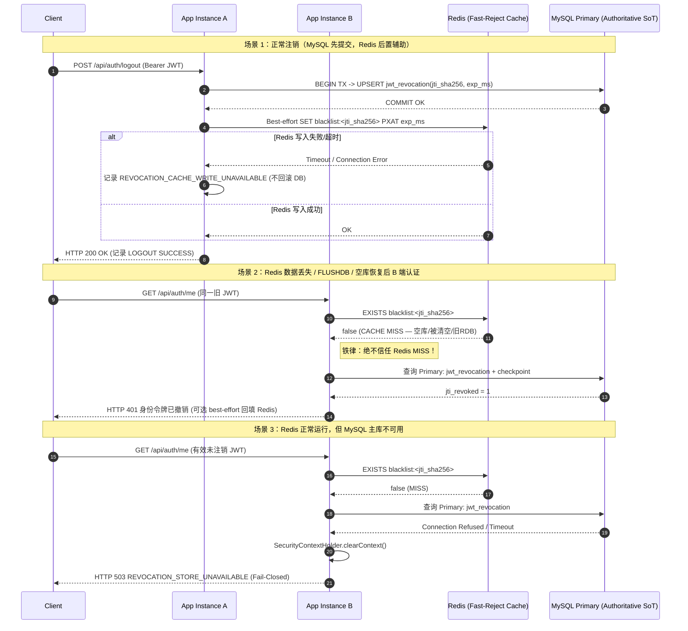

# #64 JWT 吊销状态持久化与 Redis 数据丢失安全恢复架构设计（ADR）

当前状态：`#64 OPEN / DESIGN_CANDIDATE / RED_VERIFIED`

> [!IMPORTANT]
> 本轮不修改 `src/main` 生产代码、不修改正式 MySQL Schema 或迁移脚本、不触碰生产 Redis/MySQL。文末 SQL DDL 仅为**非执行性设计草案**。在生产代码落地并完成真实 MySQL + Redis 故障/数据丢失验收前，严禁将 `#64` 标记为 `FIXED`、`FIXED_VERIFIED` 或 `PRODUCTION_SAFE`。

---

## 1. 背景与精确源码依据

上一轮真实 Redis 双 JVM 验证（见 [issue29-64-real-validation-2026-11-12.md](issue29-64-real-validation-2026-11-12.md)）已证明：当 Redis 正常停机并由同目录恢复 RDB 时，已注销 JWT 在实例 A/B 上均保持 401；但当使用空 Redis 数据目录模拟持久化数据丢失后，尚未过期的已注销 JWT 在恢复后的 Redis 环境中重新获得 HTTP 200。

### 1.1 精确源码依据（基于基线 `c74867721adea57ad16012b4785b4f952b92fe86`）

| 模块 / 文件 | 关键符号与行号 | 当前实现行为与边界 |
|---|---|---|
| `TokenRevocationService.java` | `validateConfiguration()` (`L34-53`) | 强制非 `SINGLE_INSTANCE_LOCAL` 生产环境使用 `SHARED_REDIS_REQUIRED`（否则需显式审批例外）。 |
| `TokenRevocationService.java` | `revoke(String, Instant)` (`L55-74`) | `shared()` 模式下仅调用 `redis.strictPutMarker(key, expiresAt)` 写入 Redis，无任何数据库持久化写入。 |
| `TokenRevocationService.java` | `isRevoked(String)` (`L76-92`) | `shared()` 模式下仅调用 `redis.strictContains(key)`；若 Redis 返回 `false`（键不存在），直接判定未吊销。 |
| `TokenRevocationService.java` | `requireLoginStore()` (`L94-104`) | 登录前仅向 Redis 写读 5 秒 `login-probe` 键，不校验任何持久存储。 |
| `OptionalRedisService.java` | `strictContains()` (`L67-75`) | `redis.hasKey(key) == null` 时抛 `StrictRedisException("UNCONFIRMED")`，但 `false` 被注释为“confirmed absence”。 |
| `OptionalRedisService.java` | `strictPutMarker()` (`L78-90`) | 使用 `Expiration.unixTimestamp(expiresAt.toEpochMilli(), TimeUnit.MILLISECONDS)` + `SetOption.UPSERT` 写单键 `"1"`；Redis 单节点内存写入确认不等于磁盘/跨节点持久提交。 |
| `RevocationProperties.java` | `Mode` (`L12-18`) | 仅定义 `SINGLE_INSTANCE_LOCAL` 与 `SHARED_REDIS_REQUIRED`，尚无数据库权威持久化模式。 |
| `JwtAuthenticationFilter.java` | `doFilterInternal()` (`L37-71`) | 每次携带 Bearer Token 请求：`jwtService.parseClaims()` (`L46`) → `revocations.isRevoked(claims.getId())` (`L50`) → `authService.loadUser(claims.getSubject())` (`L56`)。注意 `loadUser` **本就每次请求查询 MySQL**。 |
| `JwtService.java` | `createToken()` (`L34-43`) / `parseClaims()` (`L49-51`) | 签发 `jti`（`UUID.randomUUID()`）、`sub`、`iat`、`exp`（默认 120 分钟），不含代际/版本号。 |
| `AuthService.java` | `login()` (`L31-55`) / `logout()` (`L82-92`) / `loadUser()` (`L58-65`) | `login` 先验证密码（401）、账号/角色启用（403），再调 `requireLoginStore()`；`logout` 调用 `revocations.revoke()` 后记 `LOGOUT SUCCESS`；`loadUser` 为 `@Transactional(readOnly = true)`。 |
| `HealthController.java` | `health()` (`L22-35`) | `/api/health` 为 `permitAll()`，探测 `SELECT 1` 与 `redis.ping()`，始终返回 HTTP 200 与状态字段。 |
| `SecurityResponseWriter.java` & `GlobalExceptionHandler.java` | `write()` (`L17-22`), `handleBusiness()` (`L36-39`) | 统一返回 `ApiResponse.fail(status, message)`，401/403/503 不回显底层异常、Redis 凭据或主机地址。 |
| `RevocationEvents.java` | `record()` (`L18-33`) | 结构化安全事件与 60s 限流告警，不记录 key/token/凭据。 |
| `doc/database/backend-v1-database-guide.md` & `pom.xml` | 迁移与持久化技术栈 | 项目使用 **MyBatis + JdbcTemplate**，**无 Flyway / Liquibase**；生产迁移通过 `doc/database/migrations/V4_001`..`V4_019` 顺序手工 SQL 执行，测试 H2 同步维护 `src/test/resources/schema.sql`。 |

### 1.2 漏洞根因本质

当前问题**不是**“Redis 连接失败未拦截”。连接失败、超时、ACL 写拒绝均已被 `StrictRedisException` + `RevocationStoreUnavailableException` 拦截为 HTTP 503。

真正的结构性漏洞在于：
1. **将易失性缓存当作唯一事实源（Source of Truth）**：Redis 被用作唯一持久化存储，而项目运维契约（[backend-v1-database-guide.md](../database/backend-v1-database-guide.md)、[backend-v1-operations.md](../deployment/backend-v1-operations.md)）明确规定“Redis 无需备份，因为它不保存业务事实”。
2. **负查询结果误判（False Negative on Empty Store）**：当 Redis 因空数据目录恢复、异常宕机丢失未刷盘写入、`FLUSHDB`、缓存淘汰（eviction）或主从异步切换丢数据时，恢复后的 Redis **能够正常响应 `EXISTS = false`**；应用把“键不存在”错误地解释为“令牌未被吊销”，从而让未过期但已确认注销的 JWT 复活（HTTP 200）。

---

## 2. 安全不变量定义（INV-01 ~ INV-07）

任何候选与最终方案必须同时满足以下可自动化验证的安全不变量：

| 编号 | 安全不变量 | 验证判定标准 |
|---|---|---|
| **INV-01** | **先持久提交后成功返回**：注销接口返回 HTTP 200 与记录 `LOGOUT SUCCESS` 前，撤销事实必须在权威持久存储中完成事务提交确认。 | 若权威存储写入/提交失败，`/api/auth/logout` 必须返回非 200（503），且不得记录 `LOGOUT SUCCESS`。 |
| **INV-02** | **全实例生命周期有效拒绝**：注销成功确认后至 JWT 自然过期（`exp`）前，该令牌在所有运行实例与新启动实例中均被拒绝。 | 多 JVM 跨实例查询同一旧 JWT 必须恒返回 HTTP 401（`身份令牌已撤销`或 `身份令牌已过期`）。 |
| **INV-03** | **Redis 任意状态丢失不复活旧令牌**：Redis 数据丢失、空目录启动、重启、`FLUSHDB`、回滚到旧 RDB 快照、缓存淘汰、异步主从切换均不得使旧 JWT 重新通过认证。 | 上述任一 Redis 异常恢复后，未过期已注销 JWT 不得获得 HTTP 200。 |
| **INV-04** | **不可靠状态必须 Fail-Closed**：当无法可靠判定令牌撤销状态（权威存储不可达、超时、事务失败、未确认提交）时，必须拒绝认证/注销/登录。 | 返回 HTTP 503 `REVOCATION_STORE_UNAVAILABLE`，并清除 `SecurityContextHolder`。 |
| **INV-05** | **跨实例线性可见性**：注销成功后，任何实例上的后续认证读不得因只读副本复制延迟、本地内存缓存或未刷新快照而放行旧令牌。 | 注销返回 200 后，实例 B 立即认证必须 100% 拒绝；禁止在应用进程内缓存“未撤销”状态或路由至延迟副本。 |
| **INV-06** | **既有兼容与语义不破坏**：不得破坏无 Token `/api/health`（Redis/存储故障时仍 200 报告状态）、登录错误优先级（密码错 401 / 停用 403 优先于存储预检 503）、RBAC/DataScope 校验及非生产 `SINGLE_INSTANCE_LOCAL` 本地开发模式。 | 回归测试覆盖所有上述既有语义保持不变。 |
| **INV-07** | **凭据与令牌零泄露**：日志、HTTP 异常响应、监控指标及持久表（除单向摘要外）不得记录完整 JWT、`JWT_SECRET`、Redis 密码、数据库连接串或内部主机地址。 | 日志与响应扫描无 `eyJ...`、`Bearer <token>`、明文密码及内网 Redis URI。 |

---

## 3. 架构方案对比评估

本节完整对比三个备选方案：
- **方案 A**：MySQL 持久化 revoked-JTI 表作为唯一权威事实源（Source of Truth），Redis 仅作可选辅助缓存（**推荐方案**）。
- **方案 B**：数据库用户/会话代际（细分 **B1 用户级 `token_version`** 与 **B2 会话表 `user_session`**）。
- **方案 C**：纯 Redis 持久化、主从复制、AOF/RDB、`WAIT`/`WAITAOF` 及备份恢复约束。

### 3.1 15 维全面评估矩阵

| 评估维度 | 方案 A：MySQL 权威 revoked-JTI + Redis 辅助（推荐） | 方案 B：数据库用户/会话代际（B1 / B2） | 方案 C：纯 Redis AOF/RDB + 复制 + WAIT/WAITAOF |
|---|---|---|---|
| **1. 安全不变量（INV-01~07）** | **全部满足**（前提：严禁将 Redis MISS 当作未吊销，MISS 必须回源 MySQL 主库）。 | B1 满足除“单设备独立注销”外的所有 INV；B2 全部满足。 | **无法严格保证 INV-01 / INV-03 / INV-05**（详见 3.2 节约束分析）。 |
| **2. 单令牌注销语义** | **精确支持**：按 `jti_sha256` 精确吊销当前令牌。 | B1 **不支持**（一次注销踢出同一用户全部设备）；B2 支持（按 `sid`）。 | 支持，但受限于 Redis 数据丢失窗口。 |
| **3. 多设备登录及单设备注销** | **原生支持**：同一用户多端登录产生不同 `jti`，单端注销不影响其他设备。 | B1 无法区分多设备；B2 支持但每次登录需创建会话行。 | 支持，但丢数据时全部设备旧令牌复活。 |
| **4. 注销与认证并发** | MySQL 主库 `COMMIT` 后返回 200；先于 `COMMIT` 的在途认证可能成功，**之后**所有认证因读主库最新提交均 401。 | 同左；B1/B2 对 `sys_user` 或 `user_session` 行读主库可见。 | 并发时若读写跨主从或宕机未刷盘，存在已返回 200 却未落盘窗口。 |
| **5. 数据丢失与错误恢复** | **抗 Redis 全丢**：Redis 空库、`FLUSHDB`、旧 RDB 恢复均只产生缓存 MISS，回源 MySQL 主库仍拒绝旧令牌；MySQL 依赖标准 ACID 与常规备份。 | 同左，依赖 MySQL 持久化；且不依赖 Redis 即可保安全。 | **高危**：空目录启动、误删卷、旧 RDB 覆盖 AOF、内存淘汰均直接导致旧令牌复活（本轮 RED 已证）。 |
| **6. Redis 故障** | **安全降级可用**：Redis 宕机/超时时，认证与注销直连 MySQL 主库，仍满足 INV-01~05（可配置告警，不再整体 503）。 | 可完全不依赖 Redis；若用 Redis 缓存代际仍需应对旧快照。 | **全面不可用或安全失效**：严格模式全站 503；若降级放行则彻底失去撤销保护。 |
| **7. MySQL 故障** | **Fail-Closed 503**：注销、登录预检与 Redis MISS 认证均返回 503；`/api/health` 保持 200 并报告 `database=DOWN`。 | 全链路认证/登录/注销 fail-closed 503（注：`loadUser` 本就依赖 MySQL）。 | 若仅依赖 Redis，MySQL 宕机时 `loadUser` 仍会失败；且无法用 MySQL 兜底 Redis 丢数据。 |
| **8. 多 JVM / 多节点** | 所有实例共享同一 MySQL 主库事实源，跨节点零本地状态依赖。 | 同左。 | 需所有 JVM 严格连接同一主节点且无连接池指向滞后副本。 |
| **9. 主从复制与读写延迟** | 规定吊销读写**强制绑定 MySQL 主库**（Primary RW），禁止路由至只读副本，消除复制延迟。 | 同左，需强制读主库。 | Redis 主从为**异步复制**，Sentinel/Cluster 故障切换可能提升滞后从库，直接丢失已 ACK 的撤销写入。 |
| **10. 令牌有效期与时钟偏差** | 以 `expires_at_epoch_ms`（UTC 毫秒）比对；定期清理保留 5 分钟时钟偏差宽限期（grace skew）。 | B2 会话过期同左；B1 用户版本号无 TTL 清理需求，但需防整数溢出（BIGINT 足够）。 | 依赖 Redis 服务端 `PEXPIRETIME` 与应用主机时钟一致性，跨节点 NTP 漂移可能提前过期。 |
| **11. 延迟与吞吐成本** | **可接受**：`JwtAuthenticationFilter` 每次请求**本就执行 `authService.loadUser()` 访问 MySQL 2~4 次**；增加 1 次唯一索引点查（约 0.2~0.5ms）成本极低；Redis 仅命中黑名单时省去 DB 点查（防失效令牌重放风暴）。 | B1 可直接合并进 `authMapper.selectByUsername()`（0 额外 SQL），代价是丧失单设备注销；B2 每登录多 1 次 INSERT、每请求多 1 次 `sid` 校验。 | 网络 RTT 最低，但开启 `appendfsync always` + `WAIT`/`WAITAOF` 后写入尾延迟剧增且受网络抖动阻塞。 |
| **12. 存储规模与清理成本** | 仅存“有效期内提前注销”的令牌，默认有效期 120 分钟；按峰值每小时数千次注销计，表规模常驻仅数百~数万行，有界批量清理极快。 | B1 零额外表增长；B2 需为**每次登录**建行（比仅存注销行大 1~2 个数量级）。 | 内存存储，受 `maxmemory` 限制；一旦触发淘汰策略即丢失黑名单。 |
| **13. 生产部署复杂度** | **低**：复用现有 MySQL 8 唯一事实源；Redis 保持可选加速角色，完全契合仓库运维指南。 | **低~中**：同样复用现有 MySQL 8，无需新增运维组件。 | **极高**：需部署 Redis Sentinel/Cluster、AOF `always`、RDB/AOF 异地备份、禁止空目录启动护栏、`min-replicas-to-write`、禁用 `FLUSHDB`/淘汰等，且 Windows 环境无官方企业级支持。 |
| **14. 数据迁移及回滚风险** | 新增独立表 + 检查点表，**不改业务表结构**；切换需配合 `min_valid_iat_epoch_ms` 或 `JWT_SECRET` 轮换，PITR 回滚须执行强制失效 SOP（详见第 5、6 节）。 | 需修改 `sys_user` 表或新增会话表，且必须改造 `JwtService` Payload 契约与现有测试。 | 无法通过 SQL 脚本保证，高度依赖外部基础设施人工配置审计。 |
| **15. 对现有代码的侵入程度** | **低~中**：无需改动 JWT 载荷格式、`LoginVO`、业务 Controller 或前端；仅扩展 `TokenRevocationService`、`RevocationProperties` 及新增 MyBatis/JDBC 持久化与切面。 | B1 改 `JwtService` + `AuthMapper` + `sys_user`；B2 需大改登录/会话生命周期与大量既有测试断言。 | 仍需改造应用支持 `WAIT`/`WAITAOF`/epoch 护栏，且无法消除空库恢复后的结构性盲区。 |

### 3.2 为何不能仅靠方案 C（即使启用 AOF/RDB 与 WAIT/WAITAOF）

设计评审中常见误区是认为“只要给 Redis 配上 `appendonly yes` + `appendfsync always` + `WAIT`，就可以保证所有已确认撤销不丢失”。本项目明确否决该假设，原因如下：
1. **`appendfsync everysec` 存在 1~2 秒丢失窗口**；即使设为 `always`，仍无法防御宿主磁盘损坏、容器/脚本以空目录挂载重启、人工误操作或 `FLUSHDB`。
2. **`WAIT` / `WAITAOF` 无法提供分布式强一致线性提交**：Redis 复制为异步流；当主节点写入本地内存后若 `WAIT` 超时，撤销标记其实已留存在原主节点但客户端收到失败，或主节点在复制到多数派前宕机、Sentinel 仍可能触发人工/自动故障切换提升滞后从库；`WAITAOF` 在单机双盘或主从切换时同样受限于 Redis 的非 Raft 共识模型。
3. **空目录恢复误判不可消除**：一旦发生任何基础设施失误导致 Redis 以空库启动，应用层无法从 `EXISTS = false` 区分“从未吊销”与“Redis 刚丢了数据”。
4. **违背项目既有运维契约**：[backend-v1-database-guide.md](../database/backend-v1-database-guide.md) 与 [backend-v1-operations.md](../deployment/backend-v1-operations.md) 明确规定 Redis 仅为可选缓存且无需备份。

### 3.3 推荐方案结论

**推荐采用方案 A（MySQL 持久化 `jwt_revocation` + `jwt_revocation_checkpoint` 为权威事实源，Redis 仅作可选“已吊销快速拒绝缓存”），并吸收方案 B1 的轻量全局/用户级时间水位线思想用于上线安全切换与应急失效。**

核心理由：
- 彻底消除 Redis 数据丢失/空库恢复/旧 RDB 导致的旧令牌复活（满足 INV-01~05）。
- 精确保留单设备/单令牌注销语义，不改变 JWT Payload 或前端登录/注销协议（满足 INV-06）。
- `JwtAuthenticationFilter` 本就每请求访问 MySQL `loadUser`，增加 1 次定长 `CHAR(64)` 主键/唯一索引点查在性能上完全可控，且 Redis 仍可拦截高频已吊销重放请求。

---

## 4. 方案 A 详细设计（面向下一轮开发）

### 4.1 持久化记录的数据字段与摘要脱敏规则

1. **禁止存储原始 JWT**：遵循 INV-07 与 [backend-sensitive-data-audit.md](../security/backend-sensitive-data-audit.md)，数据库与 Redis 中绝不保存完整 JWT 字符串。
2. **存储 `jti_sha256`（`CHAR(64)`）**：对 JWT 的 `jti`（UUID 字符串）做小写 64 位十六进制 SHA-256 摘要（与仓库 `V4_016_s4a_entity_resolution.sql` 中的 `resolution_token_sha256 CHAR(64)` 规范一致），作为定长业务主键/唯一键，避免超长或异常 `jti` 导致的索引截断与日志泄露风险。
3. **核心表结构语义**：
   - **`jwt_revocation`**（已撤销令牌表）：
     - `revocation_id` (`BIGINT AUTO_INCREMENT PK`)
     - `jti_sha256` (`CHAR(64) NOT NULL`) — 唯一键 `uk_jwt_revocation_jti_sha256`
     - `user_id` (`BIGINT NULL`) — 关联 `sys_user.user_id`（仅作审计溯源，认证主查询不依赖它）
     - `expires_at_epoch_ms` (`BIGINT NOT NULL`) — JWT `exp` 的 UTC 毫秒时间戳（**所有过期判定与清理比较均以此整型列为准，彻底规避 MySQL `serverTimezone`、夏令时与多 JVM 本地时区差异**）
     - `token_expires_at` (`DATETIME(3)` / H2 `TIMESTAMP` `NOT NULL`) — 人类可读过期时间（UTC 或与连接时区一致，仅供 DBA 巡检）
     - `revoked_at` (`DATETIME(3)` / H2 `TIMESTAMP` `NOT NULL`) — 注销提交时间
     - `revocation_reason` (`VARCHAR(32) NOT NULL DEFAULT 'LOGOUT'`) — 预留 `LOGOUT` / `ADMIN_REVOKE`
     - `instance_id` (`VARCHAR(64) NULL`) / `trace_id` (`VARCHAR(64) NULL`) — 来自 `S2TraceContext`
     - `created_at` (`DATETIME(3)` / H2 `TIMESTAMP` `NOT NULL DEFAULT CURRENT_TIMESTAMP`)
   - **`jwt_revocation_checkpoint`**（全局/切换时间水位表）：
     - `checkpoint_key` (`VARCHAR(64) PK`) — 固定 `'GLOBAL_JWT_CUTOFF'`
     - `checkpoint_status` (`VARCHAR(20) NOT NULL DEFAULT 'UNINITIALIZED'`) — 显式三态枚举：`UNINITIALIZED | READY | INVALID`
     - `min_valid_iat_epoch_ms` (`BIGINT NULL`) — 仅当 `checkpoint_status = 'READY'` 且 `min_valid_iat_epoch_ms IS NOT NULL AND min_valid_iat_epoch_ms >= 0` 时有效；凡 `(iat_epoch_sec * 1000) < min_valid_iat_epoch_ms`（或缺失 `iat`）的 JWT 一律视为已失效（401）
     - `activated_at` (`DATETIME(3)` / H2 `TIMESTAMP` `NULL`) — 首次从 `UNINITIALIZED` 激活至 `READY` 的时刻
     - `updated_by` (`VARCHAR(64) NULL`) / `updated_at` (`DATETIME(3)` / H2 `TIMESTAMP` `NOT NULL DEFAULT CURRENT_TIMESTAMP`)

### 4.1.1 检查点状态机、Fail-Closed 契约与 `iat` 秒级精度规则（审查阻断项 A）

为彻底防止“检查点行缺失/未初始化/损坏被 `COALESCE(..., 0)` 掩盖”进而导致存量或已吊销令牌意外放行，检查点表必须严格遵守以下 **10 条强安全约束**：

1. **缺失检查点行 → Fail-Closed 503**：查询 `checkpoint_key = 'GLOBAL_JWT_CUTOFF'` 返回 0 行时，**严禁 `COALESCE(..., 0)`**，认证与登录预检必须抛出 `RevocationStoreUnavailableException`，返回 HTTP `503 REVOCATION_STORE_UNAVAILABLE`。
2. **检查点字段无效 → Fail-Closed 503**：当 `checkpoint_status` 为 `UNINITIALIZED`、`INVALID` 或未知值，或 `min_valid_iat_epoch_ms` 为 `NULL` / `< 0`（以及明显异常负值）时，一律视为检查点不可信，认证与登录预检 **Fail-Closed 返回 HTTP 503**，绝不放行。
3. **数据库查询失败 → Fail-Closed 503**：访问 `jwt_revocation` 或 `jwt_revocation_checkpoint` 发生连接异常、超时、表缺失、SQL 异常时，立即清空 `SecurityContextHolder` 并返回 HTTP `503`。
4. **生产启动强门禁**：在 `DURABLE_DB_REQUIRED` 模式下启动应用时，启动自检必须验证 `GLOBAL_JWT_CUTOFF` 行存在，且 `checkpoint_status = 'READY'`、`min_valid_iat_epoch_ms IS NOT NULL AND min_valid_iat_epoch_ms >= 0`；缺失、`UNINITIALIZED` 或 `INVALID` 时直接**拒绝启动（fail-fast）**。
5. **旧系统升级强制水位校核**：从 `SHARED_REDIS_REQUIRED` 升级至 `DURABLE_DB_REQUIRED` 时，部署脚本/运维流程必须先将 `checkpoint_status` 显式切换为 `READY`，并将 `min_valid_iat_epoch_ms` 设置为大于等于切换边界的 UTC 毫秒值（见第 10 条精度对齐规则），并经预检确认生效后方可启动 `v_new`。
6. **禁止“空表 + 0 水位”放行存量 JWT**：DDL 初始化脚本仅写入 `checkpoint_status = 'UNINITIALIZED'` 与 `min_valid_iat_epoch_ms = NULL`（或未激活态的占位值）；**任何升级或生产环境都不得把初始化态或 `0` 自动当作已完成安全切换并放行此前签发的存量 JWT**。
7. **水位更新必须单调不减**：更新 `GLOBAL_JWT_CUTOFF` 时必须执行条件更新：仅允许 `WHERE checkpoint_key = 'GLOBAL_JWT_CUTOFF' AND (min_valid_iat_epoch_ms IS NULL OR #{newCutoffMs} >= min_valid_iat_epoch_ms)`（建议显式要求 `> 0` 且在重装/紧急踢出时单调递增），**禁止回拨检查点水位**。
8. **禁止普通启动脚本重置既有水位**：迁移与测试/部署初始化脚本必须使用幂等非覆盖插入（例如 `INSERT IGNORE` / `ON DUPLICATE KEY UPDATE checkpoint_key = checkpoint_key`），**绝对禁止在 `GLOBAL_JWT_CUTOFF` 已存在并处于 `READY` 时将其重置为 `0` 或 `UNINITIALIZED`**。
9. **数据库恢复旧快照 / PITR 回滚强制安全约束**：若对 MySQL 执行冷备还原或基于时间点的恢复（PITR），会导致 `jwt_revocation` 中还原点之后的撤销记录丢失，且 `min_valid_iat_epoch_ms` 可能倒退回更旧时间点。因此任何历史库恢复**必须配合安全恢复 SOP**（见第 5.4 节：强制轮换 `JWT_SECRET` 或推进 `min_valid_iat_epoch_ms` 并清除全部在线会谈凭证），未完成安全处理前禁止接入外部流量。
10. **JWT `iat` 秒级精度与 `cutoff` 毫秒精度关系及首次激活规则**：
    - `JwtService.createToken()` (`L34-43`) 构造 `Date.from(now)` 交由 JJWT 按 RFC 7519 序列化 `iat` 为**整秒级 Unix 时间戳**（例如 `now = 1794537300.850s` 时，JWT 内 `iat` 为 `1794537300`，反序列化回 Java `claims.getIssuedAt().toInstant().toEpochMilli()` 时毫秒固定为 `1794537300000L`）。
    - **精度陷阱与修正**：若在 `T_cutover = 1794537300.850s` 直接将 `cutoff` 设为 `1794537300850L`，则同一整秒内（`1794537300.851s`~`.999s`）随后新签发的合法 JWT 其 `iatMs` 仍为 `1794537300000L < 1794537300850L`，将被误判撤销；反之若简单向下截断为 `1794537300000L`，则同一秒更早时刻（`.100s`）签发的切前旧令牌也会逃逸放行。
    - **强制对齐规则**：设置/提升 `min_valid_iat_epoch_ms` 时，必须将其对齐至**下一整秒上界**：`cutoffMs = ((T_cutover_ms / 1000L) + 1L) * 1000L`，并在放开登录/写流量前等待至多 1 秒跨过该整秒边界（`clock.millis() >= cutoffMs`）。认证比较使用 `iatEpochMs < min_valid_iat_epoch_ms`（若 `iat == null` 同样拒绝）。由此保证：所有切前旧令牌严格满足 `iatEpochMs <= T_cutover_sec * 1000 < cutoffMs`（100% 拒绝），所有切后新令牌严格满足 `iatEpochMs >= cutoffMs`（0 误杀）。
    - **全新空库首次部署可验证激活条件**：仅当确认属于全新部署且历史上从未签发过有效 JWT（例如由运维在执行新随机 `JWT_SECRET` 生成、且 `sys_user`/业务尚未对外签发令牌的初始化窗口内），方可显式执行一次独立 `ACTIVATE` 语句将 `checkpoint_status` 由 `UNINITIALIZED` 置为 `READY` 并写入当前整秒对齐后的 `min_valid_iat_epoch_ms = ((now_ms / 1000L) + 1L) * 1000L`（禁止在未验证全新空库条件时由 DDL 默认激活为 `0`）。

### 4.2 唯一键、索引、过期时间与有界清理规则

- **唯一键**：`UNIQUE KEY uk_jwt_revocation_jti_sha256 (jti_sha256)` — 保证幂等写入与 O(log N) 点查。
- **清理索引**：`KEY idx_jwt_revocation_expires_ms (expires_at_epoch_ms)` — 支持按时间窗口低锁范围扫描删除。
- **审计索引**：`KEY idx_jwt_revocation_user_id (user_id)` — 便于安全排查某用户的近期注销记录。
- **清理规则与时钟偏差边界**：
  - `@Scheduled(fixedDelayString = "${security.jwt.revocation.cleanup-interval:PT30S}")` 定期执行有界批量清理。
  - 清理截止水位：`cleanupCutoffMs = clock.millis() - cleanupGraceSkewMs`（默认宽限 `cleanupGraceSkewMs = 300_000L`，即 5 分钟），绝不删除仍在任何节点时钟偏差容忍期内的记录。
  - 批量删除语句：`DELETE FROM jwt_revocation WHERE expires_at_epoch_ms <= #{cutoffMs} ORDER BY expires_at_epoch_ms ASC LIMIT #{batchSize}`（H2 兼容写法可先查出 `LIMIT #{batchSize}` 的 `revocation_id` 集合再按主键 `IN (...)` 删除，既避免全表锁又兼顾 MySQL 8.4 与 H2 语法统一）。
  - **清理与认证边界并发**：因清理保留 5 分钟宽限期，而 `JwtService.parseClaims()` 默认容忍偏差为 0s，故任何在宽限期内被删除的记录其 JWT 早已被 `ExpiredJwtException` 拦截为 401 `身份令牌已过期`，不存在“刚删行但令牌未过期”的竞态窗口。

### 4.3 注销写入事务、幂等性与提交确认

1. **输入校验与过期语义**：延续 `TokenRevocationService.revoke` 现有校验，`jti` 为空或 `expiresAt` 已过期在严格/持久模式下均抛 401 `BusinessException`。
2. **MySQL 先提交事务（Transaction First）**：
   - 在独立持久化 Service（如 `JdbcTokenRevocationStore` 或 `JwtRevocationMapper`）中使用 `@Transactional(propagation = Propagation.REQUIRES_NEW, rollbackFor = Exception.class)` 执行幂等 upsert：
     - MySQL：
       ```sql
       INSERT INTO jwt_revocation (
           jti_sha256, user_id, expires_at_epoch_ms, token_expires_at,
           revoked_at, revocation_reason, instance_id, trace_id
       ) VALUES (
           #{jtiSha256}, #{userId}, #{expiresAtEpochMs}, #{tokenExpiresAt},
           #{revokedAt}, #{reason}, #{instanceId}, #{traceId}
       )
       ON DUPLICATE KEY UPDATE
           expires_at_epoch_ms = GREATEST(expires_at_epoch_ms, VALUES(expires_at_epoch_ms))
       ```
     - H2 `MODE=MySQL`：可使用 `MERGE INTO jwt_revocation (jti_sha256, ...) KEY (jti_sha256) VALUES (...)` 或捕获 `DuplicateKeyException` 后执行单条 `UPDATE ... WHERE jti_sha256 = ? AND expires_at_epoch_ms < ?`（跨数据库零方言差异的最佳实现为：`INSERT` → 若报 `DuplicateKeyException` 则确认存在且必要时延长 `expires_at_epoch_ms`，确保幂等重复注销均成功返回）。
   - **禁止先写 Redis 再提交 MySQL**：绝不允许出现在 MySQL 事务回滚时 Redis 已写入脏黑名单的情况。
3. **Post-Commit 写 Redis 辅助缓存**：
   - 仅当 MySQL 事务**已确认提交成功**后，再执行 best-effort `redis.strictPutMarker(redis.key("security:jwt:blacklist:" + jtiSha256), expiresAt)`（或沿用 `jti` 派生键，建议统一为 `jtiSha256` 以防键名携带原始结构）。
   - 若此时 Redis 写入失败（连接断开、ACL 拒绝、超时）：记录 `REVOCATION_CACHE_WRITE_UNAVAILABLE` 告警并计数，**但注销接口仍返回 HTTP 200 且记录 `LOGOUT SUCCESS`**，因为 MySQL 权威状态已提交，后续所有实例在 Redis MISS 时会直接从 MySQL 主库读取到该吊销记录。
   - 若 MySQL 写入或事务提交失败：立即抛出 `RevocationStoreUnavailableException`（HTTP 503），**不写 Redis、不写 `LOGOUT SUCCESS` 审计、不放行返回 200**。

### 4.4 认证读取顺序、检查点即时一致性与 Redis 信任边界（审查阻断项 B）

> [!CAUTION]
> **核心铁律**：
> 1. 绝对禁止在任何生产/多实例模式中将 Redis 的“键不存在（MISS）”直接认定为“令牌未撤销”。
> 2. **严禁对 `GLOBAL_JWT_CUTOFF` 水位做进程内 TTL 缓存（如 5s 缓存）**：用于强制全量失效或安全切换的水位一旦更新，若因各 JVM 本地缓存刷新延迟导致其它实例在窗口期内继续返回 HTTP 200，将直接违反 INV-02 与 INV-05。因此**本设计彻底取消 JVM 本地水位缓存**，强制每次认证从 MySQL 主库读取权威检查点状态与水位。

严格认证读取顺序（`JwtAuthenticationFilter` → `TokenRevocationService.isRevoked`）：
1. **JWT 验签与基础声明校验**（`JwtService.parseClaims`）：验证 HMAC 签名、`exp > now`、`jti` 非空、`iat` 非空。过期返回 401 `身份令牌已过期`；签名/格式错误或缺失必要声明返回 401 `身份令牌无效`。
2. **Redis 辅助快速拒绝缓存（仅允许正向命中拒绝，不允许 MISS 放行）**：
   - 若 Redis 已启用且可用，尝试查询 `blacklist:<jti_sha256>`：
     - 若返回 `true`（**快速拒绝命中**）：**立即拒绝**，返回 401 `身份令牌已撤销`，记录 `REVOCATION_REJECTED_CACHE`（无需再查询 MySQL；已确认单向吊销的 `jti` 只增不减，不会因水位升高而恢复有效）。
     - 若返回 `false`（**Redis MISS**）或 Redis 抛出超时/连接/ACL 异常：记录缓存异常统计（若异常），**严禁放行，必须无条件进入步骤 3 查询 MySQL 主库**。
3. **权威 MySQL 主库单次联合点查（Authoritative Primary Query）**：
   - 使用独立连接/非长事务快照，强制路由至 **MySQL Primary (RW)** 执行单次联合查询（与 `jwt_revocation` 合并为 **1 次往返，0 额外延迟，0 实例间缓存漂移**；**严禁使用 `COALESCE(..., 0)` 掩盖缺失行**）：
     ```sql
     SELECT
       EXISTS(
         SELECT 1 FROM jwt_revocation
         WHERE jti_sha256 = #{jtiSha256} AND expires_at_epoch_ms > #{nowEpochMs}
       ) AS jti_revoked,
       c.checkpoint_status,
       c.min_valid_iat_epoch_ms
     FROM jwt_revocation_checkpoint c
     WHERE c.checkpoint_key = 'GLOBAL_JWT_CUTOFF'
     ```
   - 严格判定逻辑（顺序不可颠倒）：
     1. **查询异常（连接失败、超时、表缺失、SQL 错误）** → 立即清空 `SecurityContextHolder`，抛出 `RevocationStoreUnavailableException`，返回 **HTTP 503 `REVOCATION_STORE_UNAVAILABLE`**（Fail-Closed）。
     2. **检查点行缺失（返回 0 行）或状态无效**（`checkpoint_status` 非 `'READY'`，如 `'UNINITIALIZED'` / `'INVALID'` / 未知值，或 `min_valid_iat_epoch_ms IS NULL` / `< 0`） → **Fail-Closed 返回 HTTP 503 `REVOCATION_STORE_UNAVAILABLE`**，绝不放行。
     3. **`jti_revoked == 1` 或 `iatMs == null` 或 `iatMs < min_valid_iat_epoch_ms`** → 返回 `revoked = true`（**HTTP 401 `身份令牌已撤销`**）。若 Redis 可用且仅因 `jti_revoked == 1` 拒绝（此前为 MISS），可 best-effort 回填 Redis `PXAT` 黑名单键以防重放击穿 DB；若仅因全局水位拒绝且需立即全实例统一踢出，后续实例同样通过本步骤即时读主库拒访，无视本地缓存。
     4. **仅当检查点严格为 `READY` 且 `min_valid_iat_epoch_ms >= 0`、且 `jti_revoked == 0` 且 `iatMs >= min_valid_iat_epoch_ms`** → 确认未撤销，放行至 `authService.loadUser(username)`。

### 4.5 关键事务与故障时序图



### 4.6 7 大关键故障与并发边界处理清单

| 边界场景 | 行为与机制保证 | 结果 |
|---|---|---|
| **1. MySQL 提交成功，Redis 辅助写入失败** | DB 事务先提交后才写 Redis；Redis 异常仅记限流日志与计数。 | 注销返回 200；B 端在 Redis MISS 后查 MySQL 主库仍拒绝旧 JWT（401）。 |
| **2. Redis 写入成功但 MySQL 事务回滚** | 禁止在 DB `COMMIT` 前写入 Redis；彻底根除“先写缓存后写库”导致的状态分裂。 | 不会发生脏黑名单残留；DB 回滚直接映射为 503，不记 `LOGOUT SUCCESS`。 |
| **3. DB 已提交瞬间，实例 B 同时认证** | `JwtAuthenticationFilter` 使用主库独立短读（`READ COMMITTED` / autocommit），在注销返回 200 后发起的任何请求均处于 MySQL 事务提交之后。 | B 端立即可见，返回 401（满足 INV-05）。 |
| **4. 主库提交成功，只读副本尚未同步** | 本模块显式禁止数据源读写分离到只读副本；吊销写入与回源点查均强制走 Primary RW DataSource。 | 零副本延迟复活窗口（满足 INV-05）。 |
| **5. Redis 正常但发生 `FLUSHDB`** | `FLUSHDB` 后 Redis 对所有键返回 `EXISTS = false`（MISS）；因 MISS 强制回源 MySQL 主库，仍命中 `jwt_revocation`。 | 旧 JWT 仍返回 401（满足 INV-03）。 |
| **6. Redis RDB 恢复到旧时间点快照** | 旧 RDB 缺少快照时间点之后的新注销键 → 返回 MISS → 强制查 MySQL 主库；同时因**不缓存“未撤销”正向结果**，旧 RDB 绝不会给出错误放行信号。 | 旧 JWT 仍返回 401（满足 INV-03）。 |
| **7. 定期清理与过期边界并发** | 清理任务仅删除 `expires_at_epoch_ms <= now - 300_000`（5 分钟宽限期）；此时所有满足删除条件的 JWT 均已超过 `exp` 5 分钟，必被 `JwtService.parseClaims` 拒绝为 `ExpiredJwtException` (401)。 | 清理与认证之间无竞态漏洞。 |

### 4.7 异常映射、健康检查与可观测性设计

1. **HTTP 响应契约保持**：
   - 未认证/缺 Token：401 `缺少有效身份令牌`
   - 签名/格式错：401 `身份令牌无效`
   - 已过期：401 `身份令牌已过期`
   - 已撤销或低于 `min_valid_iat_epoch_ms`：401 `身份令牌已撤销`
   - MySQL 权威吊销库不可用（认证回源、登录预检、注销写入）：503 `REVOCATION_STORE_UNAVAILABLE：身份令牌撤销服务暂不可用，请稍后重试`
   - `/api/health`：保持 `permitAll()` 无 Token 恒返回 HTTP 200，在返回体中可新增 `revocationMode` / `revocationStoreStatus`（例如 `DB_PRIMARY_UP` / `DB_PRIMARY_DOWN`）而不改变既有 `database`、`redisEnabled`、`redisStatus`、`cacheMode` 字段语义（满足 INV-06）。
2. **运行模式兼容与启动检查点校验（`RevocationProperties.Mode`）**：
   - 保留 `SINGLE_INSTANCE_LOCAL`（非 prod profile 本地开发兼容，或带显式审批的生产单机例外）。
   - 新增生产默认模式 `DURABLE_DB_REQUIRED`：
     - 启动校验（`validateConfiguration`）在 `prod/production` profile 或 `production=true` 时强制要求 `DURABLE_DB_REQUIRED`（除非显式审批单机例外）；
     - **启动检查点强制校验**：在 `DURABLE_DB_REQUIRED` 模式下启动时，应用必须查询 `jwt_revocation_checkpoint` 中的 `GLOBAL_JWT_CUTOFF` 行，确认该行**存在**、且 `checkpoint_status = 'READY'`、且 `min_valid_iat_epoch_ms IS NOT NULL AND min_valid_iat_epoch_ms >= 0`；若行缺失、处于 `UNINITIALIZED` / `INVALID`、或数据库不可达，应用**直接 fail-fast 拒绝启动**（不得以 `0` 或空表静默上线）。
   - 若显式配置 `SHARED_REDIS_REQUIRED` 作为过渡兼容模式，应在启动日志中发出高优先级安全告警提示其不抗 Redis 空恢复，禁止将其用于替代 `DURABLE_DB_REQUIRED` 的生产验收。
3. **监控指标、审计事件与告警**：
   - 在 `RevocationEvents` 中维持有界事件名（禁止输出 `jti` 明文、JWT、密码、Redis/DB URI）：
     - `REVOCATION_DB_CONFIRMED` (`LOGOUT` 成功落库)
     - `REVOCATION_DB_UNAVAILABLE` (`LOGOUT` / `LOGIN_PREFLIGHT` / `AUTHENTICATE` / 检查点缺失或 `UNINITIALIZED`/`INVALID` 触发 503 紧急告警)
     - `REVOCATION_REJECTED_CACHE` / `REVOCATION_REJECTED_DB` / `REVOCATION_REJECTED_CUTOFF`
     - `REVOCATION_CACHE_WRITE_UNAVAILABLE` / `REVOCATION_CACHE_READ_UNAVAILABLE`（Redis 辅缓存异常告警；注意 `v_new` 下服务不中断，但若处于 `v_bridge` 阶段仍必须 fail-closed 503）
     - `REVOCATION_CLEANUP_BATCH`（记录清理行数与耗时，不记录明细）

---

## 5. 上线切换、混合部署、回滚与数据库恢复安全方案

### 5.1 为什么禁止“直接建空表 + 0 水位切新代码”

上线瞬间，系统中可能存在此前由旧版本签发并已在 Redis 中注销、但新表 `jwt_revocation` 内尚未记录的 JWT：
- 若直接启用 `v_new` 且以默认 `0` 水位（或 `COALESCE(..., 0)`）查询空表，一旦 Redis 发生重启/丢数据/换新前缀，`v_new` 查询空表会认为这些旧令牌全部有效，直接造成**已撤销令牌大规模复活**。
- **因此绝对禁止通过 `UNINITIALIZED`、空表或 `0` 水位直接放行升级前签发的存量 JWT！**

### 5.2 推荐切换方案（优先停机维护窗口）与高精度水位切分

| 方案 | 流程与原子要求 | 安全性与精度证明 |
|---|---|---|
| **方案 1：维护窗口停旧启新（推荐，默认生产路径）** | 1. 停止所有 `v_old` 实例接收流量（进入维护窗口，关闭登录/业务入口）。<br>2. 备份当前 MySQL，执行 `V4_020_jwt_revocation.sql`（创建表并将 `GLOBAL_JWT_CUTOFF` 初始写入为 `UNINITIALIZED`）。<br>3. 按整秒对齐规则计算切流水位：`cutoffMs = ((nowEpochMs / 1000L) + 1L) * 1000L`；显式执行激活 SQL 将 `GLOBAL_JWT_CUTOFF` 更新为 `checkpoint_status = 'READY'`、`min_valid_iat_epoch_ms = GREATEST(COALESCE(min_valid_iat_epoch_ms, 0), cutoffMs)`（并可同步轮换 `JWT_SECRET`，详见 [backend-v1-operations.md](../deployment/backend-v1-operations.md) 第 6 条）。<br>4. 等待至 `clock.millis() >= cutoffMs`（至多 1 秒）以跨过 `iat` 秒级整秒边界，然后**先验证检查点已处于 `READY` 且水位有效**，再启动 `v_new` 实例。 | 所有升级前签发的旧令牌满足 `(iat_sec * 1000) < cutoffMs`，无论是否曾写入新表、无论 Redis 是否清空，一律返回 401 强制重新登录；所有 `v_new` 启动后签发的新令牌满足 `(iat_sec * 1000) >= cutoffMs` 且 100% 处于 MySQL 持久吊销管控之下。 |
| **方案 2：全新空库首次部署可验证激活条件** | 仅当满足全部可验证前提：**目标库为全新初始化库、历史上从未对外签发有效 JWT（或同步配置了全新生成的随机 `JWT_SECRET` 且在线无历史客户端流量）** 时，由部署初始化步骤执行一次显式激活 SQL，将 `checkpoint_status` 从 `UNINITIALIZED` 更新为 `READY`、`min_valid_iat_epoch_ms = ((nowEpochMs / 1000L) + 1L) * 1000L` 并等待至 `clock.millis() >= cutoffMs` 后再启动应用。 | 即使新库刚建表，也不依赖“0 水位默认有效”假设；`V4_020` 自身保持 `UNINITIALIZED`，未经显式激活无法放行请求或通过启动检查。 |
| **方案 3：双阶段滚动过渡版本 `v_bridge`（仅在明确禁止维护窗口时启用）** | 若运维强制禁止停机窗口而保留 `v_bridge`：<br>1. `v_bridge` 开启**双写强一致确认（Dual-Write ACK）**：`POST /api/auth/logout` 期间，MySQL 主库提交 **AND** 旧 Redis 写入**两者都必须成功确认**，才允许返回 HTTP 200 与记录 `LOGOUT SUCCESS`；**只要 `v_old` 仍在运行，若旧 Redis 写入失败则 `v_bridge` 必须返回 503**（绝不能仅提交 MySQL 后返回 200，否则随后打到 `v_old` 的请求会立刻复活！）。认证阶段 `v_bridge` 同时查 Redis 与 MySQL，任一命中即拒。<br>2. 当全部实例确认升级至 `v_bridge` 且再无 `v_old` 实例在线后，将 `GLOBAL_JWT_CUTOFF` 显式单调推进至 `T_all_bridge`（整秒对齐，并等待 >= 1s）或等待超过完整 `JWT_EXPIRE_MINUTES`（默认 120 分钟），再滚动切换至 `v_new`。 | 消除了 `v_bridge` + `v_old` 混跑期间在 `v_bridge` 注销（Redis 失败却返回 200）→ `v_old` 放行的致命窗口。 |

### 5.3 混合部署与版本回滚铁律

1. **严禁 `v_old` 与 `v_new` 直接混跑**：`v_new` 允许 Redis 辅缓存写入失败降级返回 200（依赖 MySQL 主库），而 `v_old` 只读取 Redis；二者直接混跑会在任何 Redis 抖动/空库时导致已在 `v_new` 成功注销的令牌在 `v_old` 立刻复活。
2. **上线前 DDL 失败处理**：`V4_020` 仅新增两张独立表，不修改业务表。若切换前 DDL 失败，`v_old` 与现有业务完全不受影响。
3. **版本回滚强制约束（`v_new` → `v_old`）**：
   - 只要 `v_new` 对外服务过，期间发生的任意一次 Redis 辅写入失败、Redis 重启、淘汰或空恢复，都会导致“MySQL 有记录但旧 Redis 缺失记录”。
   - **回滚铁律**：从 `v_new` 回滚到只读 Redis 的 `v_old` 时，**必须同时轮换 `JWT_SECRET`（使所有此前签发及已注销 JWT 一次性全部失效）**，严禁保留同一 `JWT_SECRET` 直接回滚！

### 5.4 MySQL 备份还原 / PITR 回滚安全恢复 SOP（审查新增约束）

MySQL 成为 JWT 吊销权威事实源后，数据库级时间点恢复（PITR）或从旧备份快照还原将直接带来安全风险：
- **风险本质**：若于 `T_restore` 时刻将 MySQL 还原至较早快照时刻 `T_backup`，则 `[T_backup, T_restore]` 区间内所有已提交的 `jwt_revocation` 行以及可能上调过的 `GLOBAL_JWT_CUTOFF` 水位**都会随数据库一并回退丢失**；若仍允许还原前的存量未过期 JWT 继续访问，这部分本已注销/被踢出的令牌将在重启流量后复活。
- **强制恢复 SOP（恢复流量前必须 100% 完成）**：
  1. 恢复期间保持所有后端应用实例下线或处于维护拦截状态，禁止在恢复后直接开放外网业务流量。
  2. 执行以下两项失效措施之一（优先同时执行）：
     - **A（首选，最彻底）**：立即**轮换生产环境变量 `JWT_SECRET`**，令所有历史 JWT 签名立即失效；并将 `GLOBAL_JWT_CUTOFF.min_valid_iat_epoch_ms` 单调推进至当前恢复后时刻的下一整秒（`((now_ms / 1000) + 1) * 1000`）。
     - **B（若受限暂不改密钥）**：由 DBA 在 MySQL 主库确认 `jwt_revocation_checkpoint` 为 `READY` 且**强制推进水位**至 `GREATEST(min_valid_iat_epoch_ms, ((now_ms / 1000) + 1) * 1000)`，等待跨过整秒边界后再启应用（确保还原时间点之前签发的所有未过期 JWT 均低于新水位而被强制 401 重新登录）。
  3. 同时执行一次 Redis 黑名单关联核验或直接清理残留过期键（注意即使不清理 Redis，由于已改密钥或提升水位，旧令牌亦无法复用），确认 `/api/health` 与检查点启动自检全部通过后再恢复外部入口。

---

## 6. 非执行性 SQL DDL 与操作脚本草案（供下一轮评审）

> [!NOTE]
> 以下 SQL 未在本轮执行，仅作为设计附录。正式迁移文件应按仓库顺序命名（紧随 `V4_019_migration_batch_reuse.sql` 之后，建议 `doc/database/migrations/V4_020_jwt_revocation.sql`），并同步更新 `src/test/resources/schema.sql`。

### 6.1 MySQL 8.4 DDL 草案（`V4_020_jwt_revocation.sql`）

```sql
-- =============================================================================
-- DRAFT ONLY (NON-EXECUTABLE IN THIS DESIGN ROUND)
-- V4_020: Issue #64 - Durable JWT revocation store and fail-closed checkpoint.
-- Target: MySQL 8.4, apply after V4_019 on a backed-up database.
-- =============================================================================
USE population_miniterm;

CREATE TABLE IF NOT EXISTS jwt_revocation (
    revocation_id BIGINT NOT NULL AUTO_INCREMENT,
    jti_sha256 CHAR(64) NOT NULL COMMENT 'SHA-256 hex digest of JWT jti claim',
    user_id BIGINT NULL COMMENT 'Optional sys_user.user_id for security audit',
    expires_at_epoch_ms BIGINT NOT NULL COMMENT 'JWT exp claim in UTC epoch milliseconds',
    token_expires_at DATETIME(3) NOT NULL COMMENT 'Human-readable token expiration timestamp',
    revoked_at DATETIME(3) NOT NULL COMMENT 'Authoritative revocation timestamp',
    revocation_reason VARCHAR(32) NOT NULL DEFAULT 'LOGOUT' COMMENT 'LOGOUT | ADMIN_REVOKE',
    instance_id VARCHAR(64) NULL COMMENT 'App instance id from S2TraceContext',
    trace_id VARCHAR(64) NULL COMMENT 'Request trace id from S2TraceContext',
    created_at DATETIME(3) NOT NULL DEFAULT CURRENT_TIMESTAMP(3),
    PRIMARY KEY (revocation_id),
    UNIQUE KEY uk_jwt_revocation_jti_sha256 (jti_sha256),
    KEY idx_jwt_revocation_expires_ms (expires_at_epoch_ms),
    KEY idx_jwt_revocation_user_id (user_id)
) ENGINE=InnoDB DEFAULT CHARSET=utf8mb4 COLLATE=utf8mb4_unicode_ci;

CREATE TABLE IF NOT EXISTS jwt_revocation_checkpoint (
    checkpoint_key VARCHAR(64) NOT NULL,
    checkpoint_status VARCHAR(20) NOT NULL DEFAULT 'UNINITIALIZED' COMMENT 'UNINITIALIZED | READY | INVALID',
    min_valid_iat_epoch_ms BIGINT NULL COMMENT 'Must be non-null >= 0 when READY; reject iat_ms < cutoff',
    activated_at DATETIME(3) NULL COMMENT 'First cutover activation timestamp',
    updated_by VARCHAR(64) NULL,
    updated_at DATETIME(3) NOT NULL DEFAULT CURRENT_TIMESTAMP(3) ON UPDATE CURRENT_TIMESTAMP(3),
    PRIMARY KEY (checkpoint_key),
    CONSTRAINT chk_jwt_checkpoint_status CHECK (checkpoint_status IN ('UNINITIALIZED', 'READY', 'INVALID')),
    CONSTRAINT chk_jwt_checkpoint_ready_cutoff CHECK (
        checkpoint_status <> 'READY' OR (min_valid_iat_epoch_ms IS NOT NULL AND min_valid_iat_epoch_ms >= 0)
    )
) ENGINE=InnoDB DEFAULT CHARSET=utf8mb4 COLLATE=utf8mb4_unicode_ci;

-- 仅在行不存在时插入 UNINITIALIZED 占位；若已有 READY 水位，绝不覆盖或重置为 0！
INSERT IGNORE INTO jwt_revocation_checkpoint (
    checkpoint_key, checkpoint_status, min_valid_iat_epoch_ms, updated_by
) VALUES (
    'GLOBAL_JWT_CUTOFF', 'UNINITIALIZED', NULL, 'V4_020_DDL_INIT'
);
```

### 6.2 检查点显式激活与单调更新 SQL 草案（运维切流 / 应急踢出专用）

```sql
-- =============================================================================
-- EXPLICIT ACTIVATION / MONOTONIC CUTOFF ADVANCE (NOT AUTO-EXECUTED ON STARTUP)
-- Aligned to next whole UTC second boundary: ((UNIX_TIMESTAMP(UTC_TIMESTAMP(3)) DIV 1) + 1) * 1000
-- Operator must wait >= 1s after UPDATE before reopening login traffic!
-- =============================================================================

-- 1) 首次切流 / 新库显式激活（或单调上推水位）：禁止降级、禁止回拨
UPDATE jwt_revocation_checkpoint
SET
    checkpoint_status = 'READY',
    min_valid_iat_epoch_ms = GREATEST(
        COALESCE(min_valid_iat_epoch_ms, 0),
        (FLOOR(UNIX_TIMESTAMP(UTC_TIMESTAMP(3))) + 1) * 1000
    ),
    activated_at = COALESCE(activated_at, UTC_TIMESTAMP(3)),
    updated_by = 'OPS_CUTOVER_OR_ROTATION'
WHERE checkpoint_key = 'GLOBAL_JWT_CUTOFF'
  AND checkpoint_status IN ('UNINITIALIZED', 'READY');

-- 2) 校验检查点就绪（期望严格返回 1 行且 status='READY'、cutoff > 0）
SELECT checkpoint_key, checkpoint_status, min_valid_iat_epoch_ms, activated_at, updated_by, updated_at
FROM jwt_revocation_checkpoint
WHERE checkpoint_key = 'GLOBAL_JWT_CUTOFF';
```

> [!WARNING]
> 注意上例中的 `COALESCE(min_valid_iat_epoch_ms, 0)` **仅用于单调 `GREATEST(...)` 更新比较中读取前值 `NULL` 时的最大下界保护**，绝不用于认证查询路径！认证路径严格按照第 4.4 节执行无 `COALESCE` 联合查询并检查 `checkpoint_status = 'READY'`。

### 6.3 H2 2.3.232 测试 Schema 兼容草案（`src/test/resources/schema.sql`）

```sql
-- H2 MODE=MySQL parity draft (TIMESTAMP instead of DATETIME(3))
CREATE TABLE IF NOT EXISTS jwt_revocation (
    revocation_id BIGINT GENERATED BY DEFAULT AS IDENTITY PRIMARY KEY,
    jti_sha256 CHAR(64) NOT NULL,
    user_id BIGINT NULL,
    expires_at_epoch_ms BIGINT NOT NULL,
    token_expires_at TIMESTAMP NOT NULL,
    revoked_at TIMESTAMP NOT NULL,
    revocation_reason VARCHAR(32) NOT NULL DEFAULT 'LOGOUT',
    instance_id VARCHAR(64) NULL,
    trace_id VARCHAR(64) NULL,
    created_at TIMESTAMP NOT NULL DEFAULT CURRENT_TIMESTAMP,
    CONSTRAINT uk_jwt_revocation_jti_sha256 UNIQUE (jti_sha256)
);
CREATE INDEX IF NOT EXISTS idx_jwt_revocation_expires_ms ON jwt_revocation (expires_at_epoch_ms);
CREATE INDEX IF NOT EXISTS idx_jwt_revocation_user_id ON jwt_revocation (user_id);

CREATE TABLE IF NOT EXISTS jwt_revocation_checkpoint (
    checkpoint_key VARCHAR(64) PRIMARY KEY,
    checkpoint_status VARCHAR(20) NOT NULL DEFAULT 'UNINITIALIZED',
    min_valid_iat_epoch_ms BIGINT NULL,
    activated_at TIMESTAMP NULL,
    updated_by VARCHAR(64) NULL,
    updated_at TIMESTAMP NOT NULL DEFAULT CURRENT_TIMESTAMP,
    CONSTRAINT chk_jwt_checkpoint_status CHECK (checkpoint_status IN ('UNINITIALIZED', 'READY', 'INVALID')),
    CONSTRAINT chk_jwt_checkpoint_ready_cutoff CHECK (
        checkpoint_status <> 'READY' OR (min_valid_iat_epoch_ms IS NOT NULL AND min_valid_iat_epoch_ms >= 0)
    )
);
-- 注意：H2 测试夹具默认模拟“受控新库初始化”，显式以 READY + 0 作为初始测试基线（生产 V4_020 必须保持 UNINITIALIZED 直至运维切流激活）；
-- 且仅当行不存在时写入（WHERE NOT EXISTS），严禁覆盖测试中途修改过的水位。
INSERT INTO jwt_revocation_checkpoint (checkpoint_key, checkpoint_status, min_valid_iat_epoch_ms, activated_at, updated_by)
SELECT 'GLOBAL_JWT_CUTOFF', 'READY', 0, CURRENT_TIMESTAMP, 'TEST_SCHEMA_INIT'
WHERE NOT EXISTS (
    SELECT 1 FROM jwt_revocation_checkpoint WHERE checkpoint_key = 'GLOBAL_JWT_CUTOFF'
);
```

*注：`user_id` 故意不加外键约束至 `sys_user`（或采用 `NULL` 可选），以便合成单测、`TokenRevocationService` 直接按 JTI 测试及未来异步清理都能保持独立解耦；不阻碍安全审计。*

---

## 7. 代码模块级实施清单与门禁阶段分离

### 7.1 模块级实施清单

| 文件 / 模块 | 下一轮变更内容 |
|---|---|
| `doc/database/migrations/V4_020_jwt_revocation.sql` | 正式落地 `jwt_revocation` 与 `jwt_revocation_checkpoint`（`UNINITIALIZED | READY | INVALID`）及升级预检/整秒对齐激活/PITR 回滚 SOP。 |
| `src/test/resources/schema.sql` | 同步新增两张表的 H2 `MODE=MySQL` 定义，并使用非覆盖 `INSERT ... WHERE NOT EXISTS` 初始化测试检查点行。 |
| `RevocationProperties.java` | `Mode` 增加 `DURABLE_DB_REQUIRED`；新增 `cleanupGraceSkew`（默认 `PT5M`）、`dbCleanupBatchSize`（默认 `500`）等配置。 |
| `security/DurableRevocationStore.java`（新增）+ `mapper/JwtRevocationMapper.xml` | 封装主库 `REQUIRES_NEW` 事务幂等写入、无 `COALESCE` 单次联合查询（`jti_revoked` + `checkpoint_status` + `min_valid_iat_epoch_ms`）、单调水位更新、健康探活及分批清理；统一异常/缺失/`UNINITIALIZED`/`INVALID` 映射为 `RevocationStoreUnavailableException`。 |
| `TokenRevocationService.java` | `validateConfiguration()` 校验生产环境强制 `DURABLE_DB_REQUIRED` 且启动检查点为 `READY`；`revoke(...)` 先提交 DB 再 best-effort 写 Redis；`isRevoked(...)` 先检查 Redis fast-reject 命中（401），MISS 或异常时无条件回源 MySQL 主库；`requireLoginStore()` 探活 DB 与检查点状态；`cleanupExpired()` 清理 DB 过期批次。 |
| `JwtAuthenticationFilter.java` & `AuthService.java` | 传入 `claims.getIssuedAt()` 与 `userId` 给 `TokenRevocationService`，不改动 `JwtService` Payload 契约与 `LoginVO`。 |
| `HealthController.java` | 新增 `revocationStoreStatus` / `revocationMode` 非敏感字段，保留 `permitAll()` 与 HTTP 200 语义。 |
| `RevocationEvents.java` | 新增 DB/Cache/Checkpoint 分离事件与限流统计，继续严格禁用明文 JTI/JWT/密码日志。 |

### 7.2 门禁两阶段分离契约（审查阻断项 C）

为避免“用旧 `SHARED_REDIS_REQUIRED` 门禁或双 JVM 各自独立的 H2 内存库冒充未来 `DURABLE_DB_REQUIRED` 生产安全验收”，验证阶段严格拆分如下：

1. **`BASELINE_RED`（基线缺陷复现门禁，当前已实现并可执行）**：
   - 固定运行模式：`SHARED_REDIS_REQUIRED`；允许双 JVM 各自使用隔离 H2 + 同一隔离真实 Redis 8.10.3。
   - 入口：`Issue64DurabilityRedGateTest`（`-Dissue64.red=true`）与 `python scripts/issue64/issue64_red_gate.py --stage baseline-red`。
   - 预期结论：空 Redis 恢复后未过期旧 JWT 返回 HTTP `200`，判定 **`RED`（退出码 `2`）**；该门禁**仅用于表征基线结构性漏洞**。
2. **`TARGET_GREEN`（方案 A 目标生产验收门禁，本轮状态：`NOT_RUN`）**：
   - 必须运行于 **`DURABLE_DB_REQUIRED`** 模式。
   - 两个独立 JVM **必须接入同一权威持久数据库**（推荐独立 MySQL 8.4 测试库；或显式共享 TCP 数据库实例），**严禁把两个 JVM 各自独立的 `jdbc:h2:mem:...` 内存库冒充共享持久库**。
   - 关键行为差异：Redis 停机或丢失数据时，认证通过 MySQL 权威库安全完成（已吊销 `T1` 返回 `401`，有效 `T2` 返回 `200`，不再固定期望 Redis 停机返回 `503`）；MySQL 不可用或检查点缺失/`UNINITIALIZED`/`INVALID` 时返回 `503`。
   - 入口：`Issue64TargetGreenGateTest`（`-Dissue64.target.green=true`，依赖目标模式前置）与 `python scripts/issue64/issue64_red_gate.py --stage target-green`；在 `src/main` 尚未落地 `DURABLE_DB_REQUIRED` 或未提供共享 DB 连接前，门禁必须明确失败为 `ERROR`（或记录 `NOT_RUN`），**绝不允许伪造 `PASS`**。

### 7.3 建议拆分顺序（下一轮生产施工）

1. **Step 1（Schema 与 Store 层）**：提交 `V4_020_jwt_revocation.sql`、`schema.sql`、`JwtRevocationMapper` 与 `DurableRevocationStore`，配套 H2 与 MySQL 8.4 幂等插入、检查点三态 fail-closed、单调更新、并发清理单测。
2. **Step 2（核心吊销协议与模式切换）**：升级 `RevocationProperties`、`TokenRevocationService`、`JwtAuthenticationFilter`、`AuthService`、`HealthController` 与 `RevocationEvents`；调整并扩充 `S5A1StrictRevocationHttpIntegrationTest`、`RevocationConfigurationTest`、`TokenRevocationServiceConsistencyTest`。
3. **Step 3（`TARGET_GREEN` 门禁验收）**：连接共享 MySQL 8.4 测试库运行 `scripts/issue64/issue64_red_gate.py --stage target-green` 验证由 `NOT_RUN` 转为 `PASS`，并逐项执行 [issue64-durable-revocation-gate.md](issue64-durable-revocation-gate.md) 全矩阵验收后，方可提交独立审查。
